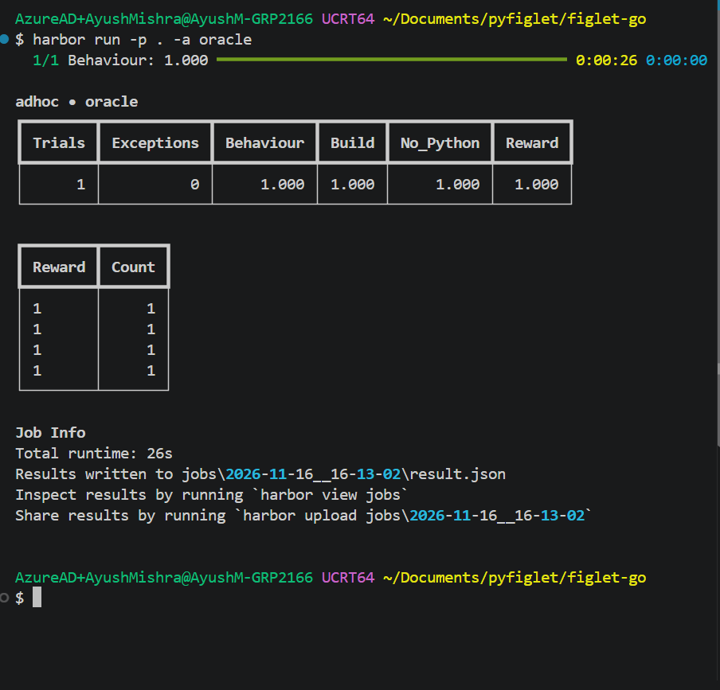
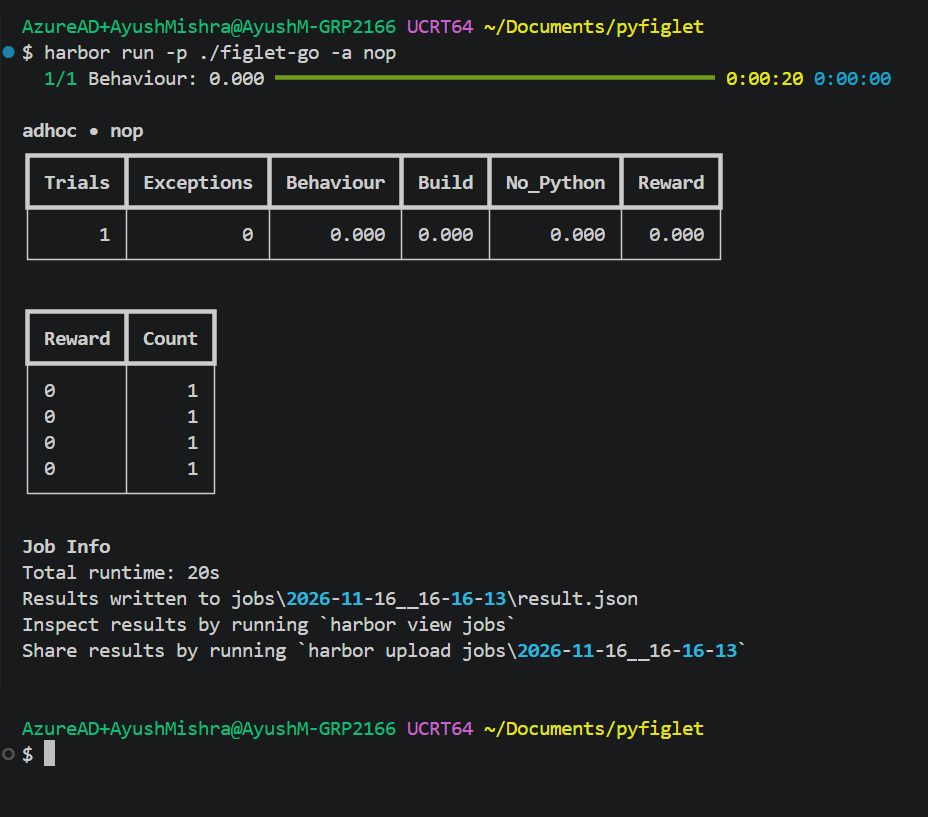
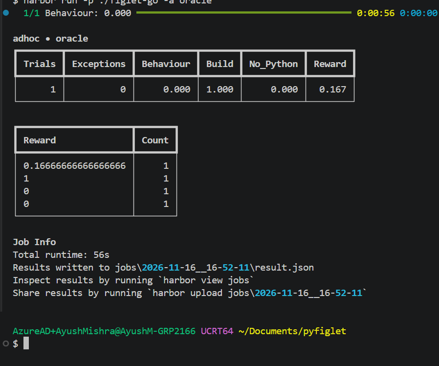

# The Machine That Shouts in Giant Letters (FIGlet Go Port)

## Table of contents

- [Project overview](#project-overview)
- [Original project and attribution](#original-project-and-attribution)
- [Features](#features)
- [Technology stack](#technology-stack)
- [Repository structure](#repository-structure)
- [Docker environment](#docker-environment)
- [Build and usage](#build-and-usage)
- [Testing and grading](#testing-and-grading)
- [Evaluation results](#evaluation-results)
- [Challenges and lessons learned](#challenges-and-lessons-learned)
- [Project status](#project-status)

## Project overview

FIGlet renders text as large character-art banners using FIGlet font (`.flf`) files. The original Python `pyfiglet` project provides a FIGlet-compatible renderer and font collection. This Harbor task asks for its rendering behavior to be ported to Go, with output matching the pinned Python implementation byte for byte for the supported command-line options and test inputs.

The Go program is generated in the Harbor workspace by `solution/solve.sh`; it is not checked in as a standalone Go application. The test-data generator expects a clean checkout of the pinned upstream `pyfiglet` project beside this task directory.

## Original project and attribution

- **Upstream project:** [pwaller/pyfiglet](https://github.com/pwaller/pyfiglet)
- **Pinned source revision:** `255827efbc09d662875dad50fa0edc1e1263bf45`
- **License:** MIT

This project uses the upstream source and standard FIGlet fonts as the behavioral and rendering reference. The original project and its contributors retain their respective copyright. Consult the upstream repository and its `LICENSE` file for the full license text.

## Features

The requested port implements the following behavior, as defined by the task instructions and the Go source emitted by `solution/solve.sh`:

- Select a FIGlet font with `-f`.
- Wrap rendered text using a requested width with `-w`.
- Align output with `-j auto|left|center|right`.
- Choose text flow with `-D auto|left-to-right|right-to-left`.
- Apply FIGlet kerning and horizontal smushing, including the six standard smushing rules.
- Reverse output (`-r`) and flip output (`-F`).
- Strip surrounding newlines (`-s`) or normalize them (`-n`).
- Use the standard font files staged by the environment and embedded in the generated Go executable.

The task explicitly does not require the `-c`, `-L`, `-l`, or `-i` options. No other unrequested behavior is claimed here.

## Technology stack

| Component | Use |
|---|---|
| Go 1.23 | Builds the generated command-line renderer. |
| Go standard library | Implements the renderer without third-party Go dependencies. |
| Docker | Builds the Harbor agent environment in two stages. |
| Harbor | Supplies the task environment, solution workflow, and verifier. |
| FIGlet fonts | Standard `.flf` files are staged in the repository and embedded into the generated binary using Go's `embed` package. |

## Repository structure

```text
.
├── README.md
├── NOTES.md
├── .gitignore
├── jobs/
├── screenshots/
│   ├── cheat.png
│   ├── nop.png
│   └── oracle.png
├── cheat/
│   └── solve.sh
├── environment/
│   └── Dockerfile
├── solution/
│   └── solve.sh
├── tests/
│   ├── data/
│   │   ├── hidden.jsonl
│   │   └── visible.jsonl
│   ├── Dockerfile
│   ├── gen.py
│   ├── grade.go
│   └── test.sh
├── instruction.md
└── task.toml
```

- **`environment/`** defines the agent's Docker image.
- **`solution/`** contains the Harbor reference solution script. It writes the Go module and source into `/workspace/repo`, stages fonts, removes Python source files from that workspace, formats the Go code, and builds it.
- **`cheat/`** contains a separate visible-output lookup script used to demonstrate why visible cases alone are not sufficient for grading. It is not the FIGlet implementation.
- **`tests/`** contains the test generator, verifier grader, and test launcher. Its `Dockerfile` is for the verifier image.
- **`tests/data/`** contains the visible and hidden JSONL corpora. The hidden file is verifier data and its cases and expected outputs are not documented here.
- **`instruction.md`** defines the task and implementation constraints for the agent.
- **`task.toml`** configures the Harbor task, including the agent, timeouts, network mode, and build timeout.
- **`NOTES.md`** is a companion upstream-source reference. It records source verification for licensing, font setup, smushing, and CLI behavior.
- **`screenshots/`** contains the recorded Harbor run screenshots shown below.
- **`jobs/`** contains local Harbor run records used for the evaluation table.

## Docker environment

The [environment Dockerfile](environment/Dockerfile) has two stages:

1. **`source`** starts from `alpine/git:v2.47.2`, clones the upstream repository, checks out the pinned commit, removes `.git`, `pyfiglet/fonts-contrib`, and `test-fonts`, and copies `pyfiglet/fonts-standard` into `pyfiglet/fonts`.
2. **Agent image** starts from `golang:1.23.12-alpine3.21`, installs Bash, creates the `player` user with UID 1000, and copies the staged source to `/workspace/repo` owned by that user. It sets `CGO_ENABLED=0` and `GOTOOLCHAIN=local`, switches to `player`, and uses `/workspace/repo` as the working directory.

The final stage does not install a Python interpreter. The cloned source tree initially contains upstream Python source files; the reference solution removes `.py` files from `/workspace/repo` before the grader checks the workspace. The generated FIGlet font files are copied into a top-level `fonts/` directory and embedded in the Go binary.

The Dockerfile also creates an empty `/tests/data/visible.jsonl` mount target. That does not populate it with the visible corpus; Harbor mount and verifier behavior is discussed under [Challenges and lessons learned](#challenges-and-lessons-learned).

## Build and usage

The Go source is created by the Harbor reference solution rather than checked into the task directory. In a running Harbor agent environment, the reference script can be executed and the generated program built as follows:

```bash
bash /solution/solve.sh
cd /workspace/repo
go build -o /tmp/figlet .
```

Once built, invoke the program with the options before the text:

```bash
/tmp/figlet -f slant "Hello, world"
/tmp/figlet -w 40 -j center "Go FIGlet"
/tmp/figlet -D right-to-left -r -F -s "Go FIGlet"
/tmp/figlet -n "Go FIGlet"
```

`-f` chooses the font; `-w` sets the wrapping width; `-j` selects alignment; `-D` selects direction; `-r` reverses; `-F` flips; `-s` strips surrounding newlines; and `-n` normalizes surrounding newlines. The examples describe supported flags and do not claim a particular output rendering.

## Testing and grading

### Test generation

`tests/gen.py` seeds Python's random generator with `random.seed(7)` and creates 2,000 visible and 2,000 hidden records. It checks that argument combinations are unique within each dataset and disjoint across the two datasets, and verifies coverage of the required fonts, widths, justification modes, directions, transformations, and tricky text inputs. Expected output is captured by invoking the original pinned `pyfiglet` `main()`; it is not manually authored.

The generator expects a clean checkout of the pinned upstream project in a sibling `pyfiglet/` directory next to this task directory. The hidden dataset is not reproduced or described in this README.

### Grading categories

The grader in `tests/grade.go` computes three scores:

| Category | Weight | Scoring |
|---|---:|---|
| Build | 1 | One point if `go build -o /tmp/figlet .` succeeds in `/workspace/repo`; otherwise zero. |
| No Python | 1 | One point only if the build succeeds, there are no `.py` files under `/workspace/repo`, and at least one hidden case matches. |
| Behaviour | 4 | Fraction of hidden cases whose stdout matches the expected output byte for byte. Each case has a five-second timeout. |

The weighted reward is:

```text
reward = (build + no_python + 4 × behaviour) / 6
```

When and only when behaviour is exactly `1.0`, the grader reads and decodes `tests/secret.b64`, renders the decoded text using `/tmp/figlet -f slant`, and prints the result after a marker. This README intentionally does not include the secret or its contents.

The test launcher, `tests/test.sh`, changes to `/tests` and runs `go run grade.go`.

## Evaluation results

These are recorded Harbor runs from **2026-11-16**. The scores are historical run results, not a claim that a new evaluation was run while writing this README.

| Run | Build | No Python | Behaviour | Reward | Evidence |
|---|---:|---:|---:|---:|---|
| Oracle reference solution | 1.0 | 1.0 | 1.0 | **1.000** | Harbor reward record: all 2,000 hidden cases matched. |
| Nop | 0.0 | 0.0 | 0.0 | **0.000** | Harbor run result. |
| Cheat (visible-output lookup) | 1.0 | 0.0 | 0.0 | **0.167** | Harbor cheat experiment; build succeeded, but hidden behavior did not match. |

The cheat score reflects the grader's weighted formula: `(1 + 0 + 4 × 0) / 6 = 1/6`.

### Harbor run screenshots

The screenshots below show the recorded outputs for the three runs:

#### Oracle



#### Nop



#### Cheat



## Challenges and lessons learned

### Most problematic smushing rule

The available development notes do not identify one of the six individual smushing rules as the hardest. The recorded implementation issue was instead in right-to-left smushing: glyph rows were aliased and mutated during rendering. Cloning the rows fixed that behavior. This is evidence of a direction-dependent row-mutation bug, not evidence that a specific rule such as Equal, Lowline, Hierarchy, Pair, BigX, or Hardblank was the most difficult.

### Docker and Harbor test-data access

Harbor builds the agent image from `environment/`, while this task's `tests/` directory is staged for verifier use. Therefore a `COPY visible.jsonl ...` instruction fails unless the file is part of the environment build context, and `/tests/data/visible.jsonl` is not automatically available to the agent before verification.

The visible and hidden corpora share `tests/data/`. Binding that entire directory into the agent would expose `hidden.jsonl`. A visible-only read-only file bind was tried to avoid a second copy, but in this task's shared-verifier mode Harbor later failed while staging verifier tests over the mounted file (`AddTestsDirError`, with the mounted target reported as busy). The current Dockerfile creates an empty target but does not itself mount or copy visible test data. Consequently, a successful Harbor run with a visible-only bind mount has not been verified; the shared-verifier and agent-file-access configuration remains an operational limitation.

## Project status

The repository contains a Harbor task, a Go reference-solution script, a separate visible-case cheat experiment, and deterministic visible/hidden test tooling. The recorded Oracle run achieved a perfect score, while the Nop and visible-lookup cheat did not pass the hidden behavior checks. The current task configuration retains shared verification, and the visible-data bind-mount issue remains unresolved; the historical score table should not be read as verification of that mount workflow.
