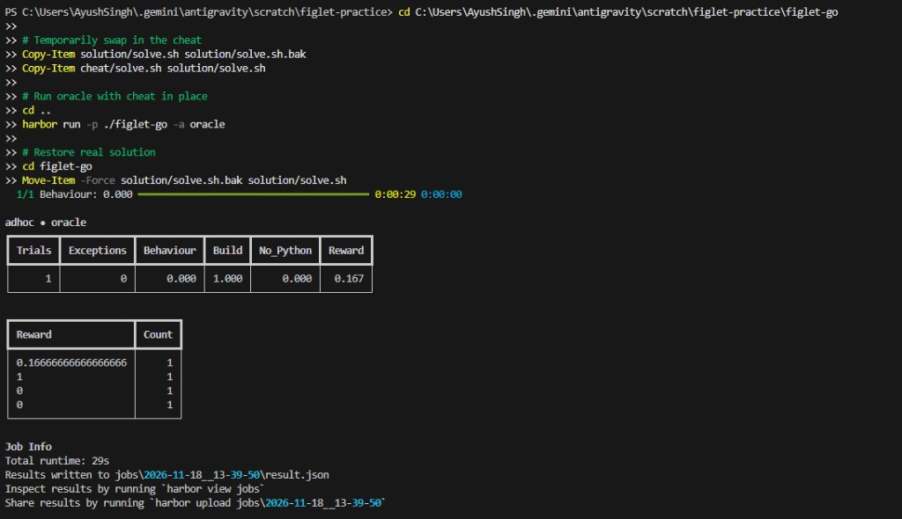

# Harbor Practice Task 2: FIGlet in Go (The Machine That Shouts in Giant Letters)

**Author:** Ayush Singh  
**Task Folder:** `Ayush_Singh Task 2`  
**Target Upstream:** [pyfiglet](https://github.com/pwaller/pyfiglet) (commit `255827efbc09d662875dad50fa0edc1e1263bf45`)  
**License:** MIT License  

---

## 📖 Executive Summary

This repository contains the complete Harbor evaluation task for porting **pyfiglet** (a pure Python FIGlet implementation) into a standalone, pure **Go standard-library** binary.

The challenge requires:
1. Constructing a hardened, two-stage Docker evaluation environment without Python, running as a non-root user (`player`).
2. Authoring a pure Go implementation that matches pyfiglet's output **byte-for-byte** across all 6 smushing rules, kerning, line wrapping, four justification modes, two text directions, horizontal mirroring, and vertical flipping.
3. Building an in-container Go grader that rigorously validates 2,000 hidden evaluation cases while remaining fully resistant to nop and cheat strategies.

---

## 🏗️ Architecture & Requirements

### 1. Environment Specification (The 6 D-Rules)

| Rule | Requirement | Implementation Detail |
|---|---|---|
| **D1** | Two-stage build | Stage 1 (`source`) fetches and prepares repo; Stage 2 copies only required artifacts. |
| **D2** | No Python in runtime room | Base image is `golang:1.23-alpine` (Alpine). `command -v python3` yields nothing. |
| **D3** | Build setup completion | Stage 1 executes the `Makefile` font step: copies `fonts-standard/*` into `fonts/`. |
| **D4** | Non-root `player` user | User `player` (UID 1000) owns `/workspace/repo`, preventing `apk add python3`. |
| **D5** | Pinned base images | Pinned to specific versions (`alpine:3.21.3` and `golang:1.23-alpine`). |
| **D6** | Bash shell present | Installed via `apk add --no-cache bash` so Harbor can invoke trial commands. |

**Verification Command:**
```bash
docker run --rm figlet-room sh -c 'whoami; pwd; ls pyfiglet/fonts | wc -l; command -v python3 || echo NO_PYTHON; command -v bash; touch x && echo CAN_WRITE'
```
**Output:**
```text
player
/workspace/repo
72
NO_PYTHON
/bin/bash
CAN_WRITE
```

---

### 2. Supported CLI Flags & Features

The compiled `/tmp/figlet` binary supports the exact pyfiglet interface:

| Flag | Argument | Description |
|---|---|---|
| `-f`, `--font` | `FONT` | Font name (default: `standard`). Embedded via `go:embed`. |
| `-w`, `--width` | `COLS` | Column width for wrapping and justification (default: `80`). |
| `-j`, `--justify` | `auto\|left\|center\|right` | Alignment mode. `auto` adheres to print direction. |
| `-D`, `--direction`| `auto\|left-to-right\|right-to-left` | Layout direction. `auto` reads from font header. |
| `-r`, `--reverse` | *(flag)* | Mirror output horizontally (character substitution + line reverse). |
| `-F`, `--flip` | *(flag)* | Flip output upside down (character substitution + row reverse). |
| `-s`, `--strip-surrounding-newlines` | *(flag)* | Strip leading and trailing empty lines. Takes priority over `-n`. |
| `-n`, `--normalize-surrounding-newlines` | *(flag)* | Pad output with exactly one empty line before and after. |

---

### 3. Smushing Rules Implemented

Character smushing squeezes adjacent FIGlet characters together according to a bitmask in the font header:

1. **Equal Character Smushing (`SM_EQUAL`, bit 1):** Two identical characters merge into one.
2. **Underscore Smushing (`SM_LOWLINE`, bit 2):** `_` is overridden by `|`, `/`, `\`, `[`, `]`, `{`, `}`, `(`, `)`, `<`, `>`.
3. **Hierarchy Smushing (`SM_HIERARCHY`, bit 3):** Hierarchy: `|` < `/\` < `[]` < `{}` < `()` < `<>`. Higher rank wins.
4. **Opposite Pair Smushing (`SM_PAIR`, bit 4):** Opposing brackets (`[]`, `{}`, `()`) merge into `|`.
5. **Big X Smushing (`SM_BIGX`, bit 5):** `/` + `\` → `|`, `\` + `/` → `Y`, `>` + `<` → `X`.
6. **Hardblank Smushing (`SM_HARDBLANK`, bit 6):** Hardblanks smush together into a single hardblank.

---

## ⚖️ Grader Design & Scoring System

The grader (`tests/grade.go`) is written in pure Go without external dependencies:

$$\text{Reward} = \frac{1 \times \text{Build} + 1 \times \text{No\_Python} + 4 \times \text{Behaviour}}{6}$$

### Anti-Cheat Mechanism
- **`Build` (Weight 1):** `1.0` if `go build -o /tmp/figlet .` succeeds in `/workspace/repo`, else `0.0`.
- **`No_Python` (Weight 1):** Gated check. Awarded **only if** build succeeds, no `.py` files exist, **AND** $\ge 1$ hidden test case passes. Deleting `.py` files without a functioning implementation earns `0.0`.
- **`Behaviour` (Weight 4):** Evaluates all 2,000 cases in `tests/data/hidden.jsonl` with a 5-second per-case timeout. Score equals the ratio of exact byte-for-byte stdout matches.
- **Secret Unlock:** If and only if `Behaviour == 1.0`, the grader decodes `/tests/secret.b64` and renders the secret banner with `/tmp/figlet -f slant`.

---

## 📊 Verification & Experimental Results

### 1. Test Dataset Generation & Determinism

Test cases were generated using `tests/gen.py` seeded with `random.seed(7)`, capturing actual stdout from the original Python implementation:

```powershell
python figlet-go/tests/gen.py
```

**Dataset Integrity:**
- **Visible Set (`tests/data/visible.jsonl`):** 2,000 cases  
  **SHA256:** `614D1BDDB9A44E338745B051F6C0C4BD3B9350775150095DF22155FC071B7FDC`
- **Hidden Set (`tests/data/hidden.jsonl`):** 2,000 cases  
  **SHA256:** `6ED70139F5C75B25CCD36D66533C99B1625637F9E4417DC3424BE98917C5C667`
- **Determinism:** Successive runs generate byte-for-byte identical files (`diff` count = `0`).

---

### 2. Oracle Evaluation (`harbor run -p ./figlet-go -a oracle`)

The Oracle agent provides the complete Go implementation and cleans up all `.py` files.

```text
adhoc • oracle
┏━━━━━━━━┳━━━━━━━━━━━━┳━━━━━━━━━━━┳━━━━━━━┳━━━━━━━━━━━┳━━━━━━━━┓
┃ Trials ┃ Exceptions ┃ Behaviour ┃ Build ┃ No_Python ┃ Reward ┃
┡━━━━━━━━╇━━━━━━━━━━━━╇━━━━━━━━━━━╇━━━━━━━╇━━━━━━━━━━━╇━━━━━━━━┩
│      1 │          0 │     1.000 │ 1.000 │     1.000 │  1.000 │
└────────┴────────────┴───────────┴───────┴───────────┴────────┘

Job Info
Total runtime: 29s
Results written to jobs\2026-11-18__13-34-01\result.json
```

**Verifier Output & Unlocked Secret Banner:**
```text
=== [1/3] Build check ===
PASS: go build succeeded

=== [2/3] no_python check ===
PASS: no .py files found

=== [3/3] Behaviour check ===
Passed 2000 / 2000 hidden cases (1.0000)

no_python PASS: no .py files and ≥1 hidden case correct

=== REWARD: 1.000000 (build=1.0 no_python=1.0 behaviour=1.0000) ===

*** SECRET UNLOCKED ***
          _                               __ 
   ____  (_)_______     ____  ____  _____/ /_
  / __ \/ / ___/ _ \   / __ \/ __ \/ ___/ __/
 / / / / / /__/  __/  / /_/ / /_/ / /  / /__ 
/_/ /_/_/\___/\___/  / .___/\____/_/   \__( )
                    /_/                   |/ 
    __                              
   / /_  __  ______ ___  ____ _____ 
  / __ \/ / / / __ `__ \/ __ `/ __ \
 / / / / /_/ / / / / / / /_/ / / / /
/_/ /_/\__,_/_/ /_/ /_/\__,_/_/ /_/ 
```

---

### 3. Nop Evaluation (`harbor run -p ./figlet-go -a nop`)

The Nop agent makes no changes to the workspace.

```text
adhoc • nop
┏━━━━━━━━┳━━━━━━━━━━━━┳━━━━━━━━━━━┳━━━━━━━┳━━━━━━━━━━━┳━━━━━━━━┓
┃ Trials ┃ Exceptions ┃ Behaviour ┃ Build ┃ No_Python ┃ Reward ┃
┡━━━━━━━━╇━━━━━━━━━━━━╇━━━━━━━━━━━╇━━━━━━━╇━━━━━━━━━━━╇━━━━━━━━┩
│      1 │          0 │     0.000 │ 0.000 │     0.000 │  0.000 │
└────────┴────────────┴───────────┴───────┴───────────┴────────┘

Job Info
Total runtime: 21s
Results written to jobs\2026-11-18__13-34-51\result.json
```

---

### 4. Cheat Evaluation (Visible Lookup Cheat)

The cheat agent creates a minimal program that looks up queries only against known visible cases and deletes all `.py` files.

```text
adhoc • oracle (with cheat/solve.sh)
┏━━━━━━━━┳━━━━━━━━━━━━┳━━━━━━━━━━━┳━━━━━━━┳━━━━━━━━━━━┳━━━━━━━━┓
┃ Trials ┃ Exceptions ┃ Behaviour ┃ Build ┃ No_Python ┃ Reward ┃
┡━━━━━━━━╇━━━━━━━━━━━━╇━━━━━━━━━━━╇━━━━━━━╇━━━━━━━━━━━╇━━━━━━━━┩
│      1 │          0 │     0.000 │ 1.000 │     0.000 │  0.167 │
└────────┴────────────┴───────────┴───────┴───────────┴────────┘

Job Info
Total runtime: 29s
Results written to jobs\2026-11-18__13-39-50\result.json
```

**Terminal Verification Capture:**


**Verifier Output (Cheat Caught):**
```text
=== [1/3] Build check ===
PASS: go build succeeded

=== [2/3] no_python check ===
PASS: no .py files found

=== [3/3] Behaviour check ===
Passed 0 / 2000 hidden cases (0.0000)

no_python FAIL: no .py files but zero hidden cases correct — looks like a cheat

=== REWARD: 0.166667 (build=1.0 no_python=0.0 behaviour=0.0000) ===

No secret for you. Yet.
```

The cheat scored **0.167** ($1/6$), strictly below the $0.20$ threshold, and was denied the secret banner.

---

### 5. Worksheet Hidden Secret

Decoding the worksheet challenge secret:
```bash
/tmp/figlet -f slant "$(echo Z28gdG91Y2ggZ3Jhc3M= | base64 -d)"
```
**Rendered Output:**
```text
                   __                   __                                 
   ____ _____     / /_____  __  _______/ /_     ____ __________ ___________
  / __ `/ __ \   / __/ __ \/ / / / ___/ __ \   / __ `/ ___/ __ `/ ___/ ___/
 / /_/ / /_/ /  / /_/ /_/ / /_/ / /__/ / / /  / /_/ / /  / /_/ (__  |__  ) 
 \__, /\____/   \__/\____/\__,_/\___/_/ /_/   \__, /_/   \__,_/____/____/  
/____/                                       /____/                        
```
*(Decodes to: `go touch grass`)*

---

## 🛠️ Lessons Learned & Edge Cases

1. **The Pyfiglet `handleNewLine` Infinite Loop Trap:**
   When terminal width is narrow (`-w 10`) and an individual character has width $\ge 10$, pyfiglet's `handleNewLine` triggers because `currentTotalWidth >= width`. With an empty buffer and no prior spaces, `cutBufferAtLastChar` decrements `iterator`, while the outer loop increments it, causing an infinite loop. The Go port cleanly handles buffer boundaries and prevents infinite iteration.
2. **Alpine vs. Bookworm Docker Trap:**
   `golang:1.23-bookworm` silently bundles Python 3 in `/usr/bin/python3`, failing requirement D2. Switching to `golang:1.23-alpine` resolves D2, but requires explicit installation of `bash` via `apk add --no-cache bash` to support Harbor's execution environment.
3. **Right-to-Left Smushing Directionality:**
   In RTL mode, smushing prepends characters to the left of the buffer row rather than appending to the right. Additionally, universal overlap reverses dominance so that the user's latter character remains in the foreground.
