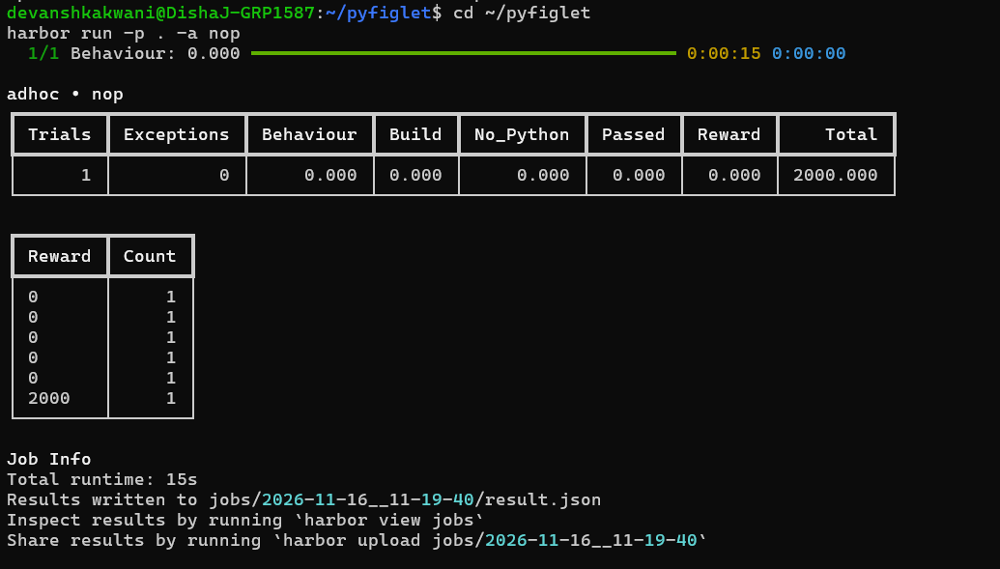
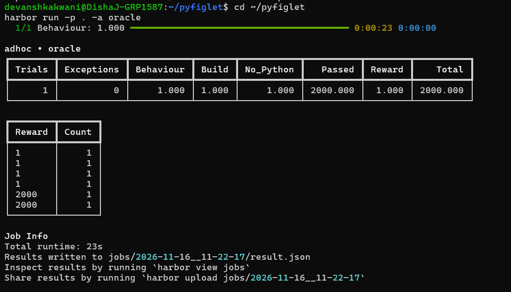
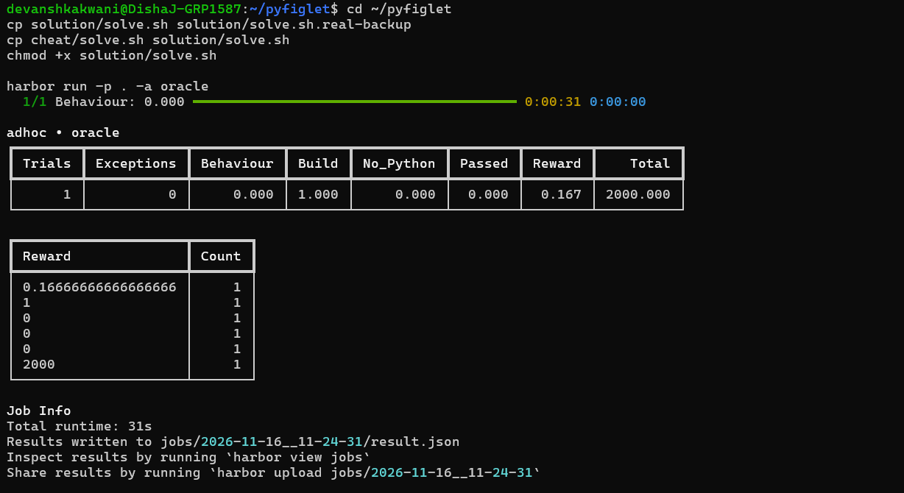

# pyfiglet → Go: Harbor task workspace

This folder holds a Harbor task
that asks an agent to port the Python
[pyfiglet](https://github.com/pwaller/pyfiglet) command-line tool to Go, with
output identical byte for byte. It also holds the material used to build and
check that task.

Only `figlet-go/` is the task and the only folder meant for GitHub.
Everything else here supports it. `figlet-go/README.md` documents the task
itself.

## Contents

```
pyfiglet/                       (this folder)
├── README.md       this file
├── NOTES.md        notes on pyfiglet: repository, commit, MIT license, why
│                   `python -m pyfiglet hello` fails on a fresh clone, kerning
│                   and the six smushing rules with verified examples, the CLI
│                   options -f -w -j -D -r -F -s -n. Kept outside the task.
├── pyfiglet/       the original pyfiglet repository, checked out at commit
│                   255827efbc09d662875dad50fa0edc1e1263bf45 (no local changes).
│                   Read while porting, and used by figlet-go/tests/gen.py and
│                   figlet-go/tests/spotcheck.py as the reference ("oracle").
├── jobs/           Harbor results: oracle-1, oracle-2, nop-1, nop-2,
│                   cheat-1, cheat-2. Not pushed.
├── figlet-go/      THE TASK (see figlet-go/README.md)
├── NOP.png         screenshot of a Harbor run with the nop agent
├── oracle.png      screenshot of a Harbor run with the oracle agent
└── cheat.png       screenshot of a Harbor run of the cheat solution
```

## The task in brief

- **Agent's environment** (`figlet-go/environment/Dockerfile`):
  `golang:1.23-alpine` with bash and a user `player` (uid 1000). The
  repository at `/workspace/repo` is pyfiglet at commit `255827ef`, with the
  67 standard `.flf` fonts copied into `pyfiglet/fonts/`. There is no Python
  in the image.
- **What the agent must build:** a Go program, `package main` at the
  repository root, using only the standard library. It must support
  `-f -w -j -D -r -F -s -n` with pyfiglet's meanings and leave no `.py`
  files in the repository.
- **Grading** (`figlet-go/tests/grade.go`, run by `tests/test.sh`):

  | Criterion | Weight | Passes when |
  |---|---|---|
  | build | 1 | `go build -o /tmp/figlet .` succeeds in `/workspace/repo` |
  | no_python | 1 | the build passes, no `.py` file remains, and at least 1 hidden case passes |
  | behaviour | 4 | fraction of the 2000 hidden cases whose stdout matches exactly (exit status 0) |

  `reward = (build + no_python + 4 × behaviour) / 6`
- **Test data** (`figlet-go/tests/data/`): 2000 visible and 2000 hidden
  cases, generated by `tests/gen.py` with seed 7 from the original pyfiglet.
  No argument list appears in both files.

## Results

The three agents (scenarios) that check the task, and what each one proves:

| Scenario | What runs | Expected reward | Proves |
|---|---|---|---|
| **nop** | nothing is done to the repository | 0.0 | an untouched repository earns nothing |
| **oracle** | `solution/solve.sh` installs the real Go port | 1.0 | the task can be solved completely |
| **cheat** | `cheat/solve.sh` installs a program that only looks answers up in the visible cases | 0.1667 | memorising the visible cases earns only the build point |

Current runs in `jobs/` (task at `figlet-go/`, run on 2026-11-16):

| Job | Agent | Reward | build | no_python | behaviour | Hidden cases passed | Runtime |
|---|---|---|---|---|---|---|---|
| oracle-1 | oracle | **1.0** | 1 | 1 | 1.0 | 2000 / 2000 | 23 s |
| oracle-2 | oracle | **1.0** | 1 | 1 | 1.0 | 2000 / 2000 | 27 s |
| nop-1 | nop | **0.0** | 0 | 0 | 0.0 | 0 / 2000 | 15 s |
| nop-2 | nop | **0.0** | 0 | 0 | 0.0 | 0 / 2000 | 16 s |
| cheat-1 | oracle on the cheat task | **0.1667** | 1 | 0 | 0.0 | 0 / 2000 | 35 s |
| cheat-2 | oracle on the cheat task | **0.1667** | 1 | 0 | 0.0 | 0 / 2000 | 38 s |

Each job's grader output is in `jobs/<job>/<trial>/verifier/reward.json`.

## Screenshots

The three screenshots are from earlier Harbor runs on 2026-11-16. The task
files then sat directly in `~/pyfiglet`, so each run used `harbor run -p .`
from that folder. The job folders they mention
(`jobs/2026-11-16__11-…`) were removed when this folder was reorganised. The
current `jobs/` runs above give the same rewards.

In each screenshot, the first table holds Harbor's averages over the job's
single trial. "Total" is the number of hidden cases (2000), and "Passed" is
how many of them matched. The second table ("Reward / Count") lists the
values of all six grader fields (reward, build, no_python, behaviour,
passed, total), one row per value.

### nop: reward 0.000



`harbor run -p . -a nop`. Runtime 15 s, job `jobs/2026-11-16__11-19-40`.
The nop agent changes nothing, so the repository has no Go code: the build
fails and every field except total is 0.

### oracle: reward 1.000



`harbor run -p . -a oracle`. Runtime 23 s, job `jobs/2026-11-16__11-22-17`.
The oracle runs `solution/solve.sh`, which installs the real Go port. Build
1, no_python 1, behaviour 1.000, and 2000 of the 2000 hidden cases pass.

### cheat: reward 0.167



`harbor run -p . -a oracle`, after replacing the solution with the cheat
(`cp solution/solve.sh solution/solve.sh.real-backup`,
`cp cheat/solve.sh solution/solve.sh`). Runtime 31 s, job
`jobs/2026-11-16__11-24-31`. The cheat compiles (build 1), but none of the
hidden cases is in the visible set, so 0 pass (behaviour 0.000). no_python
is therefore 0 as well, and the reward is 1/6 = 0.1667.

That swap worked with the cheat of that time, which carried its answer
sheet inside `solve.sh`. The current `cheat/solve.sh` reads
`cheat/visible.jsonl` beside it. The supported way to run it now, which
leaves `solution/` untouched, is:

```bash
cd figlet-go && tools/run-cheat.sh cheat-1
```

## Reproducing

From `figlet-go/`, with Docker running (WSL or Linux):

```bash
harbor run -p . -a oracle -o ../jobs --job-name oracle-1   # 1.0
harbor run -p . -a nop    -o ../jobs --job-name nop-1      # 0.0
tools/run-cheat.sh cheat-1                                 # 0.1667
tools/simulate.sh     # the same three scenarios without Harbor
tools/precheck.sh     # checks before pushing figlet-go
```

`tools/run-cheat.sh` builds a temporary `../figlet-go-cheat` (a copy of
the task whose `solution/` is the cheat), runs it, and deletes it
afterwards.
