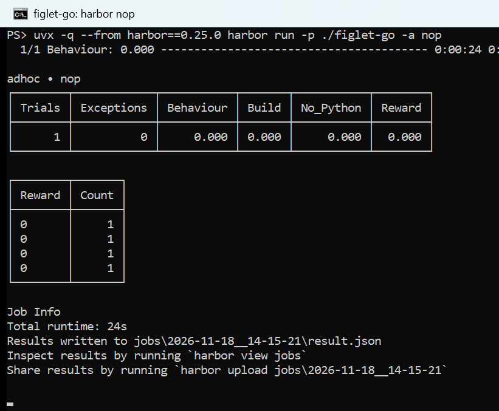

# figlet-go: port pyfiglet to Go

A Harbor task. The agent gets a snapshot of
[pyfiglet](https://github.com/pwaller/pyfiglet), a pure-Python FIGlet port, and must rewrite it as a Go
command-line program. The Go program has to print **exactly the same bytes** as pyfiglet for the same
options and text, using only the Go standard library and with no Python left in the repository.

| | |
|---|---|
| **Task name** | `local/pyfiglet-go` |
| **Source snapshot** | pyfiglet commit `255827e` (MIT licence) |
| **Agent image** | `golang:1.23-alpine` (pinned by digest) + bash, user `player`, no Python |
| **Options graded** | `-f` `-w` `-j` `-D` `-r` `-F` `-s` `-n` |
| **Grading** | 2000 hidden cases, byte-for-byte, partial credit |

## Results

| Run | Build | No_Python | Behaviour | **Reward** | Secret |
|---|:-:|:-:|:-:|:-:|:-:|
| oracle (`solution/solve.sh`) | 1 | 1 | 1.000 | **1.000** | unlocked |
| nop (does nothing) | 0 | 0 | 0.000 | **0.000** | no |
| cheat (`cheat/solve.sh`) | 1 | 0 | 0.000 | **0.167** | no |

**Oracle: 1.000**


**Nop: 0.000**



**Cheat: 0.167**


## Hand-in notes

- **Smushing rule that broke the agent most:** none; the reference port matched 4000/4000 cases on its first build, and no model agent has attempted the task yet.
- **Docker trap hit:** none of the three listed (Alpine, bash and the GitHub clone were planned from the start); the real snag was pyfiglet's `env*/` gitignore rule silently hiding `environment/`.

## Folder layout

| Path | Purpose |
|---|---|
| `instruction.md` | What the agent reads: the options, exact-output rule, fonts, hard rules and grading. |
| `task.toml` | Agent runs as `player`, 3600 s; build and verifier 900 s each; public network; shared verifier. |
| `environment/Dockerfile` | Stage 1 clones pyfiglet at the pinned commit and sets up the standard fonts. Stage 2 is the agent's room: Go 1.23 on Alpine, bash, no Python. |
| `tests/gen.py` | Builds the test cases by running the **original** pyfiglet (runs on the author's machine, not in Docker). |
| `tests/data/visible.jsonl` | 2000 cases for the author; not used for grading. |
| `tests/data/hidden.jsonl` | 2000 different cases; these are graded. |
| `tests/grade.go`, `tests/test.sh` | The verifier (Go standard library only). Writes `/logs/verifier/reward.json`. |
| `tests/secret.b64` | A message drawn by the agent's own program when it scores 100%. |
| `solution/solve.sh` | Reference solution: a full Go port of pyfiglet. |
| `cheat/solve.sh` | A program that only replays the visible answers, used to prove the grader catches it. |
| `screenshots/` | Real terminal captures of the three Harbor runs above. |
| `NOTES.md` | Notes on pyfiglet itself: licence, font setup, smushing rules, options, edge cases. |

## How it is graded

Reward = (1 × **build** + 1 × **no_python** + 4 × **behaviour**) / 6

- **build:** `go build -o /tmp/figlet .` succeeds in `/workspace/repo`. Any old binary is deleted first.
- **behaviour:** share of the 2000 hidden cases whose stdout equals pyfiglet's output byte for byte.
  - The program runs from an empty temporary folder, which checks the "works from any directory" rule.
  - Each case has a 5 s timeout and a 1 MB output cap. Exit codes and stderr are ignored.
  - The behaviour stage stops starting new cases after 600 s, so a program that hangs still gets a reward written.
- **no_python:** 1 only if the build passed, no `.py` file is left, **and** at least one hidden case matches. Deleting files alone earns nothing.
- **Secret:** at behaviour 1.0 the grader decodes `tests/secret.b64` and draws it with the agent's own `/tmp/figlet -f slant`. Below that, it prints "No secret for you. Yet."

## How the test cases were made

`tests/gen.py` uses `random.seed(7)` and produces the same files every time. Every expected output is the
captured stdout of the original pyfiglet `main()`; none was written by hand.

- **Fonts:** standard, slant, small, big, mini, banner, shadow, script.
- **Widths:** 10, 20, 40, 60, 80, 120. All `-j` and `-D` values are used, and `-r`, `-F`, `-s`, `-n` are each on in about 1 case in 4.
- **Texts:** normal words, long sentences that wrap, double spaces, smushing characters (`| / \ _ [ ] { } ( ) < >`), Latin-1 letters (`é ß ñ`), characters the fonts lack (`€ 漢 😀`), and the edge cases from `NOTES.md` (`/\`, `\/`, `><`, `<>`, `$$`).
- **No overlap:** the visible and hidden sets never share the same arguments, which is what defeats the cheat.
- **Dropped draws:** cases where pyfiglet itself crashes (`CharNotPrinted`) or never finishes are left out and replaced.
- **Checked on Linux:** all 4000 cases were replayed through pyfiglet in a Linux container with identical output.

## Running it

From the folder that contains `figlet-go` (Harbor 0.25.0):

```sh
uvx --from harbor==0.25.0 harbor run -p ./figlet-go -a oracle   # expect 1.000
uvx --from harbor==0.25.0 harbor run -p ./figlet-go -a nop      # expect 0.000
```

To score the cheat, temporarily copy `cheat/solve.sh` over `solution/solve.sh`, run the oracle command
(expect 0.167), then put the real `solve.sh` back.

To regenerate the cases, keep a pyfiglet clone at commit `255827e` next to this folder with the fonts set up
(`mkdir -p pyfiglet/fonts && cp pyfiglet/fonts-standard/* pyfiglet/fonts/`), then run `python tests/gen.py`.
