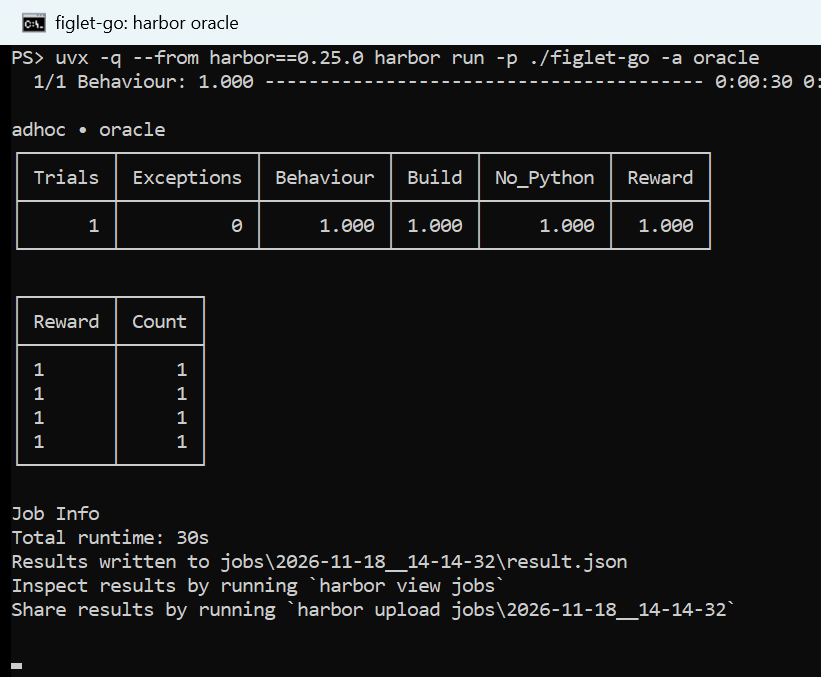
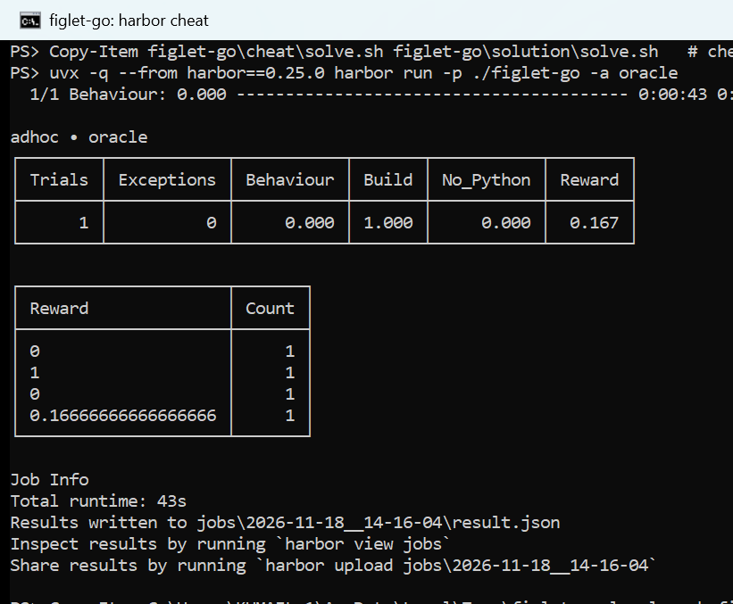

# local/pyfiglet-go

Harbor task: port pyfiglet (commit `255827e`) to Go, byte for byte, with no Python left in the repository.

## Rewards

| Run | Build | No_Python | Behaviour | Reward |
|---|---|---|---|---|
| oracle (`solution/solve.sh`) | 1 | 1 | 1.000 | **1.000** |
| nop | 0 | 0 | 0.000 | **0.000** |
| cheat (`cheat/solve.sh`, replays visible answers) | 1 | 0 | 0.000 | **0.167** |

## Notes

- **Smushing rule that broke the agent most:** none; the reference port matched 4000/4000 cases on its first build, and no model agent has attempted the task yet.
- **Docker trap hit:** none of the three listed (Alpine, bash and the GitHub clone were planned from the start); the real snag was pyfiglet's `env*/` gitignore rule silently hiding `environment/`.
