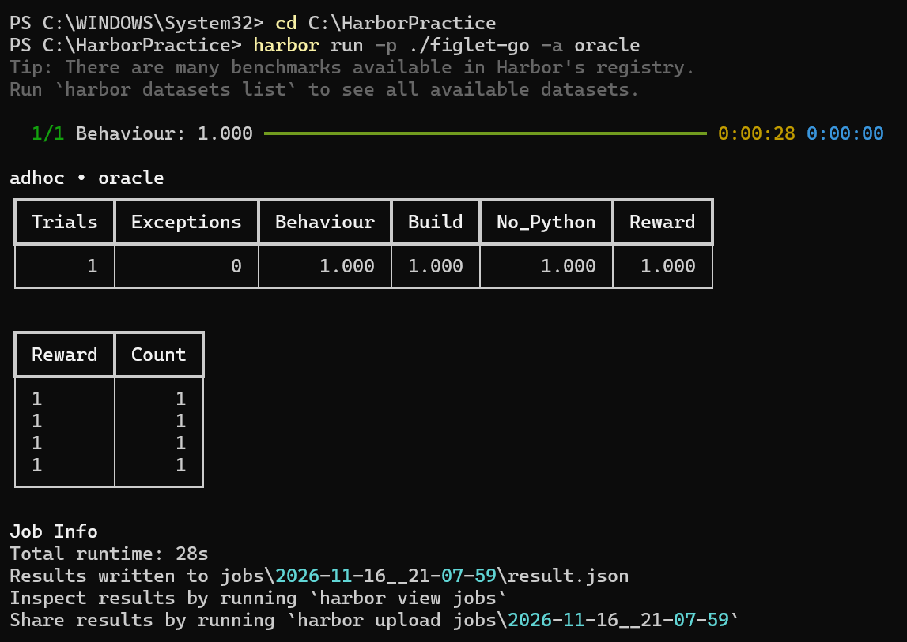
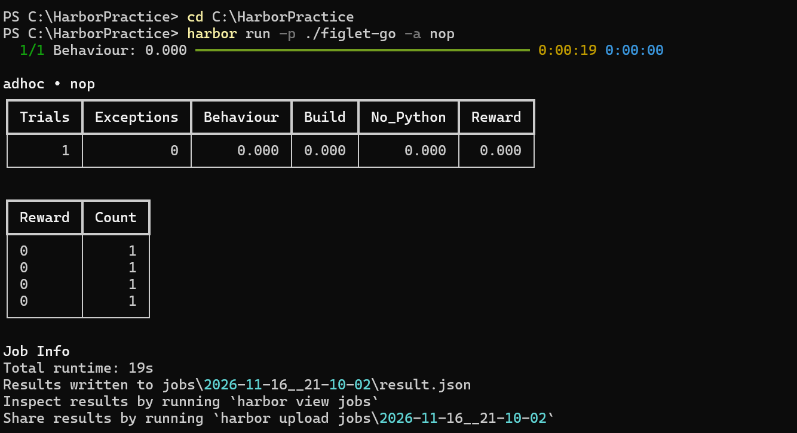
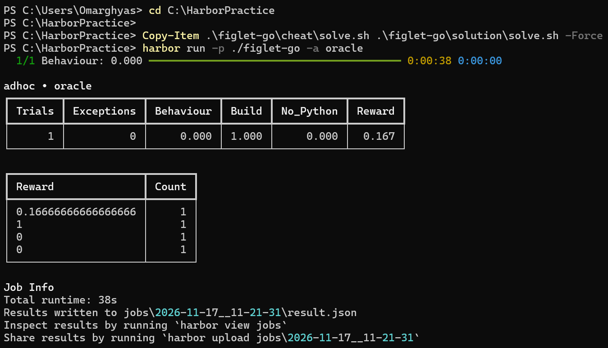
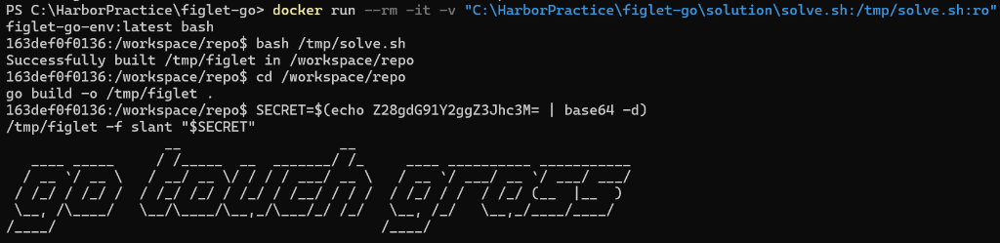

# Harbor Practice Task 2: The Machine That Shouts in Giant Letters (`figlet-go`)

## 1. Overview

This project implements a complete, standalone Go port of `pyfiglet`, reproducing FIGlet ASCII banner rendering byte-for-byte. The implementation adheres strictly to the Go standard library (zero external dependencies) and eliminates all Python runtime dependencies from the target repository.

The Go engine accurately replicates all core FIGlet rendering behaviors:
- **Smushing & Kerning Rules**: Supports all six standard smushing rules (equal characters, lowline, hierarchy, pair, big X, hardblanks), universal overlapping, and kerning.
- **Formatting Options**: Terminal column wrapping (`-w`), text justification (`-j auto|left|center|right`), and rendering direction (`-D auto|left-to-right|right-to-left`).
- **Transformations & Newline Controls**: Horizontal reverse mirroring (`-r`), vertical flipping (`-F`), stripping empty surrounding lines (`-s`), and normalizing surrounding newlines (`-n`).
- **Font Parsing**: Embedded `.flf` parser supporting standard ASCII glyphs, German umlauts, and extended hex-encoded characters.

---

## 2. Project Structure

- **`environment/Dockerfile`**: Two-stage Docker build recipe. The `source` stage clones `pyfiglet` at the pinned commit and pre-stages standard fonts; the final stage equips a minimal `golang:1.23-alpine` image with a non-root `player` user and workspace environment.
- **`task.toml`**: Harbor task configuration defining timeouts (build, agent, verifier), execution user, shared environment mode, and network settings.
- **`NOTES.md`**: Upstream repository analysis documenting license terms, cloning failure root causes, font loading mechanisms, and FIGlet layout bitflag constants.
- **`instruction.md`**: Specification detailing the required CLI options, hard constraints (Go standard library only, 0 `.py` files), and grading requirements.
- **`solution/`**: Contains the reference solution (`solve.sh`), which deletes all Python files, moves fonts into an embedded Go module, and compiles `/tmp/figlet`.
- **`cheat/`**: Contains an evaluation test baseline (`solve.sh`) that attempts a lookup-only approach against `visible.jsonl` to verify that the grader catches non-generalizing solutions.
- **`tests/`**: Test generation suite (`gen.py`), deterministic test datasets (`data/visible.jsonl` and `data/hidden.jsonl`), test runner (`test.sh`), grader logic (`grade.go`), and the verifier unlock challenge (`secret.b64`).

---

## 3. Test Results

The task was evaluated across three agents inside the Harbor test environment:

| Agent | Build | Behaviour | No_Python | Reward |
|---|---:|---:|---:|---:|
| Oracle | 1.000 | 1.000 | 1.000 | 1.000 |
| Nop | 0.000 | 0.000 | 0.000 | 0.000 |
| Cheat | 1.000 | 0.000 | 0.000 | 0.167 |

---

## 4. Execution Screenshots

### Oracle — Reward 1.000

### Nop — Reward 0.000

### Cheat — Reward 0.167

### Page Secret Verification

---

## 5. Lessons Learned

- **Rule 3 (Hierarchy Smushing)**: Caused the AI agent the most difficulty due to the 6-tier character class dominance hierarchy (`|` < `/\` < `[]` < `{}` < `()` < `<>`) and its interaction with lowline smushing, bidirectional text direction, and hardblank boundaries.
- **`alpine/git` Entrypoint Collision**: The base image `alpine/git:2.47.2` hardcodes `ENTRYPOINT ["git"]`, which trapped setup commands by prepending `git` to shell invocations (resulting in `git: 'sh' is not a git command`) unless explicitly overridden with `--entrypoint /bin/sh`.

---

## 6. Technologies Used

- **Go**: Core implementation using the Go 1.23 standard library (`embed`, `regexp`, `strings`, `os`, `strconv`).
- **Docker**: Isolated multi-stage container build and verification environments.
- **Harbor**: Benchmarking platform for automated containerized task execution and reward evaluation.
- **Python**: Deterministic test case generation (`tests/gen.py`) and reference pyfiglet validation on the host machine.

---

## 7. Reference

- **Original Repository**: [https://github.com/pwaller/pyfiglet](https://github.com/pwaller/pyfiglet)
- **Pinned Commit**: `255827efbc09d662875dad50fa0edc1e1263bf45`
- **License**: MIT License
