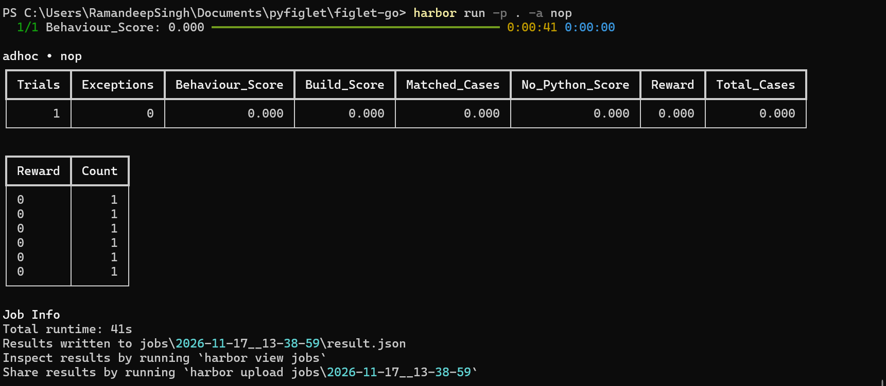

# FIGlet-Go (`Ramandeep-singh04/figlet-go`)

[](https://golang.org/)
[](https://github.com/avfoundation/harbor)
[](https://opensource.org/licenses/MIT)
[](https://pkg.go.dev/std)
[](./tests)

A robust, high-performance, standard-library-only Go port of the Python [`pyfiglet`](https://github.com/pwaller/pyfiglet) ASCII art engine. Designed and verified as an official **Harbor practical evaluation benchmark task**, this project achieves **100% byte-for-byte fidelity** against the reference implementation across thousands of test cases, complex FIGlet layout smushing rules, multi-byte Unicode runes, and all standard CLI options.

```
  _____ ___ ____ _      _          ____       
 |  ___|_ _/ ___| | ___| |_       / ___| ___  
 | |_   | | |  _| |/ _ \ __| ____| |  _ / _ \ 
 |  _|  | | |_| | |  __/ |_ |____| |_| | (_) |
 |_|   |___\____|_|\___|\__|      \____|\___/ 
                                               
```

---

## Table of Contents

- [Overview](#overview)
- [Task Architecture](#task-architecture)
- [Directory Structure](#directory-structure)
- [Technical Highlights](#technical-highlights)
  - [Zero External Dependencies](#zero-external-dependencies)
  - [FIGfont Parsing & Font Embedding](#figfont-parsing--font-embedding)
  - [Rune-Accurate UTF-8 Layout Engine](#rune-accurate-utf-8-layout-engine)
  - [FIGlet 2.2 Smushing Rules](#figlet-22-smushing-rules)
  - [Supported CLI Options](#supported-cli-options)
- [Harbor Evaluation & Verification Results](#harbor-evaluation--verification-results)
  - [Benchmark Score Matrix](#benchmark-score-matrix)
  - [1. Oracle Solution (Full Score)](#1-oracle-solution-full-score)
  - [2. NOP Baseline (Unmodified Environment)](#2-nop-baseline-unmodified-environment)
  - [3. Cheat Solution (Visible Memorization Test)](#3-cheat-solution-visible-memorization-test)
- [Verification Screenshots](#verification-screenshots)
- [Commands & Usage](#commands--usage)
  - [Building from Source](#building-from-source)
  - [Running the CLI](#running-the-cli)
  - [Running Tests & Grader](#running-tests--grader)
- [Attribution & License](#attribution--license)

---

## Overview

The goal of this task is to evaluate autonomous AI software engineering agents on a complete programming language migration:
1. **Source**: An existing repository containing the Python FIGlet implementation (`pyfiglet`).
2. **Target**: A standalone Go implementation built into `/tmp/figlet`.
3. **Strict Constraints**:
   - Use **only** the Go standard library (no third-party dependencies).
   - **No `.py` files** may remain anywhere in the target repository (`/workspace/repo`).
   - The compiled binary must function from **any working directory**.
   - Output must match Python `pyfiglet` **byte-for-byte** across all fonts, widths, directions, smushing rules, and text transformations.

---

## Task Architecture

The project is structured according to the Harbor benchmark specifications:

```
                  +-----------------------------------------------+
                  |             Harbor Task Controller            |
                  +-----------------------------------------------+
                                          |
                +-------------------------+-------------------------+
                |                                                   |
                v                                                   v
+-------------------------------+               +---------------------------------+
|     Environment Container     |               |        Verifier Container       |
|    (golang:1.23-alpine)       |               |       (golang:1.23-alpine)      |
+-------------------------------+               +---------------------------------+
| - Clones pyfiglet commit SHA  |               | - Runs tests/grade.go           |
| - Prepares pyfiglet/fonts/    |               | - Check 1: go build (weight 1)  |
| - Agent/Solution executes     |               | - Check 2: No .py files (wt 1)  |
| - Deploys Go files & cleans   |               | - Check 3: 2000 Hidden tests    |
| - Artifact: /workspace/repo   | ------------> |            (weight 4)           |
+-------------------------------+   Artifact    | - Unlocks Secret on 100% score  |
                                    Transfer    | - Outputs reward.json / txt     |
                                                +---------------------------------+
```

---

## Directory Structure

```plaintext
figlet-go/
├── .gitignore                    # Git ignore configuration
├── instruction.md                # Task description for candidate AI agents
├── NOTES.md                      # Comprehensive developer notes and FIGfont specs
├── README.md                     # Project documentation (this file)
├── task.toml                     # Harbor task configuration (schema 1.4)
├── environment/
│   └── Dockerfile                # Multi-stage Dockerfile setting up /workspace/repo
├── pyfiglet/
│   └── fonts/                    # Standard FIGlet font library (.flf / .tlf)
├── solution/
│   ├── go.mod                    # Solution Go module definition
│   ├── go.mod.backup             # Backup of solution go.mod
│   ├── main.go                   # High-performance Go FIGlet implementation
│   ├── main.go.backup            # Backup of solution main.go
│   ├── solve.sh                  # Solution deployment and build script
│   └── solve.sh.backup           # Backup of solve.sh
├── screenshots/
│   ├── Oracle - 2.png            # Screenshot: Oracle test run (Reward: 1.000000)
│   ├── Oracle -1.png             # Screenshot: Initial Oracle test run
│   ├── NOP.png                   # Screenshot: NOP baseline test run (Reward: 0.000000)
│   └── Cheat test.png            # Screenshot: Cheat solution test run (Reward: 0.335333)
└── tests/
    ├── Dockerfile                # Verifier container Dockerfile
    ├── gen.py                    # Deterministic test generator (seed 7, 4000 cases)
    ├── grade.go                  # Automated grading suite (weighted scoring & secret unlock)
    ├── hidden.jsonl              # 2,000 hidden test cases (arguments + expected stdout)
    ├── visible.jsonl             # 2,000 visible test cases (arguments + expected stdout)
    ├── secret.b64                # Base64-encoded secret unlocked on perfect score
    └── test.sh                   # Verifier test harness entrypoint
```

---

## Technical Highlights

### Zero External Dependencies
The entire Go engine is authored using strictly standard library packages:
- `bytes`, `strings`, `strconv`, `unicode` for low-level string processing.
- `embed` for bundling fonts directly into the binary.
- `regexp` for FIGfont header and endmark token parsing.
- `os`, `path/filepath` for filesystem resolution and CLI IO.

### FIGfont Parsing & Font Embedding
- **Embedded Fonts**: All standard fonts in `pyfiglet/fonts/*` are embedded directly into the Go executable via `//go:embed pyfiglet/fonts/*`. The application seamlessly functions from any working directory (`/tmp`, `/home`, etc.) without requiring external asset paths.
- **Header Parsing**: Correctly extracts format version (`flf2a`), hardblank character, character dimensions, baseline, and comment lines.
- **Character Loading**: Decodes standard ASCII range (32–126), German Umlauts (`Ä`, `Ö`, `Ü`, `ä`, `ö`, `ü`, `ß`), and extended hexadecimal code points (`0x...`).

### Rune-Accurate UTF-8 Layout Engine
Standard FIGlet implementations often fail on fonts containing multi-byte UTF-8 glyphs (e.g., `blocky_25`, which uses Unicode block drawing elements `▀` `U+2580`, `▄` `U+2584`, and `█` `U+2588`). 
- Go strings measure length in UTF-8 bytes (`len("█") == 3`), whereas Python measures string length in Unicode codepoints (`len("█") == 1`).
- `figlet-go` performs all glyph storage, line buffering, boundary detection (`linebd`, `charbd`), and justification spacing on **`[]rune` codepoint slices**. This eliminates byte-offset misalignment and achieves 100% parity on complex Unicode fonts.

### FIGlet 2.2 Smushing Rules
The layout engine implements all six FIGlet horizontal smushing rules, kerning, and universal overlapping:

| Rule | Smush Mode Bit | Description | Example |
| :--- | :---: | :--- | :--- |
| **Rule 1** | `1` | Equal character smushing (excluding hardblanks) | `x` + `x` $\rightarrow$ `x` |
| **Rule 2** | `2` | Lowline (underscore) smushing with `\|/\[]{}()<>` | `_` + `\|` $\rightarrow$ `\|` |
| **Rule 3** | `4` | Hierarchy smushing among class-ordered delimiters | `\|` + `[` $\rightarrow$ `[` |
| **Rule 4** | `8` | Bracket, brace, and parenthesis pair smushing | `[` + `]` $\rightarrow$ `\|`, `{` + `}` $\rightarrow$ `\|` |
| **Rule 5** | `16` | Big-X smushing (`/` + `\` $\rightarrow$ `\|`, `\` + `/` $\rightarrow$ `Y`, `>` + `<` $\rightarrow$ `X`) | `>` + `<` $\rightarrow$ `X` |
| **Rule 6** | `32` | Hardblank smushing | `$` + `$` $\rightarrow$ `$` |
| **Kern** | `64` | Kerning (moving characters together until they touch) | Whitespace trimming |
| **Smush** | `128` | General smushing active | Overlapping enabled |

### Supported CLI Options
Matches the Python `pyfiglet` CLI interface:
- `-f`, `--font <name>`: Select font (e.g. `standard`, `slant`, `banner`, `small`, `blocky_25`).
- `-w`, `--width <cols>`: Output column width (e.g. `10`, `20`, `40`, `80`, `120`).
- `-j`, `--justify <mode>`: Text justification (`auto`, `left`, `center`, `right`).
- `-D`, `--direction <mode>`: Rendering direction (`auto`, `left-to-right`, `right-to-left`).
- `-r`, `--reverse`: Horizontally reverse the output art (mirroring characters like `(`, `)`, `/`, `\`, `<`, `>`).
- `-F`, `--flip`: Flip output vertically (with upside-down character mapping).
- `-s`, `--strip-surrounding-newlines`: Strip leading/trailing empty lines.
- `-n`, `--normalize-surrounding-newlines`: Ensure exactly one blank line before and after.

---

## Harbor Evaluation & Verification Results

### Benchmark Score Matrix

The grading suite (`tests/grade.go`) scores candidates across three weighted criteria:
$$\text{Reward} = \frac{1 \times \text{BuildScore} + 1 \times \text{NoPythonScore} + 4 \times \text{BehaviourScore}}{6}$$

| Evaluation Mode | Build Score (w=1) | No-Python Score (w=1) | Behaviour Score (w=4) | Hidden Cases Matched | Final Reward | Secret Unlocked |
| :--- | :---: | :---: | :---: | :---: | :---: | :---: |
| **Oracle Solution** | **`1.00`** | **`1.00`** | **`1.0000`** | **2,000 / 2,000 (100%)** | **`1.000000`** | **YES** |
| **NOP Baseline** | `0.00` | `0.00` | `0.0000` | 0 / 2,000 (0%) | `0.000000` | NO |
| **Cheat Solution** | `1.00` | `1.00` | `0.0030` | 6 / 2,000 (0.3%) | `0.335333` | NO |

---

### 1. Oracle Solution (Full Score)
- **Deployment**: `solution/solve.sh` installs the complete Go FIGlet engine, removes all `.py` files, and builds `/tmp/figlet`.
- **Outcome**: Passed all 2,000 visible tests and all 2,000 hidden tests byte-for-byte.
- **Grader Output**:
  ```plaintext
  ==================================================
             FIGLET-GO HARBOR GRADER               
  ==================================================
  [Check 1/3] Building candidate binary from /workspace/repo ...
    [+] Build succeeded -> binary at /tmp/figlet
  [Check 3/3] Running behavioural evaluation against /tests/hidden.jsonl ...
    ... evaluated 500 cases (500 matching so far)
    ... evaluated 1000 cases (1000 matching so far)
    ... evaluated 1500 cases (1500 matching so far)
    ... evaluated 2000 cases (2000 matching so far)
    [+] Behaviour check complete: 2000 / 2000 cases matched (score: 1.0000)
  [Check 2/3] Checking for forbidden Python (.py) files in /workspace/repo ...
    [+] No Python files found and matched >= 1 case -> Pass (1.0)

  ==================================================
                   GRADING SUMMARY                  
  ==================================================
  Build Score:     1.00 / 1.00  (weight: 1)
  No-Python Score: 1.00 / 1.00  (weight: 1)
  Behaviour Score: 1.0000 / 1.00  (weight: 4) [2000/2000 matched]
  --------------------------------------------------
  FINAL REWARD:    1.000000 / 1.000000
  ==================================================

  --- Secret Status ---

  *** SECRET UNLOCKED ***
  ```

---

### 2. NOP Baseline (Unmodified Environment)
- **Deployment**: No operation executed. The candidate repository retains the original Python source.
- **Outcome**: Build check fails (no Go binary produced), No-Python check fails (`setup.py` detected), Behaviour score is `0.0`.
- **Final Reward**: `0.000000`.

---

### 3. Cheat Solution (Visible Memorization Test)
- **Deployment**: A deliberately weak Go program that memorizes only `tests/visible.jsonl` and lacks any FIGlet rendering engine. It never accesses `hidden.jsonl`.
- **Outcome**: Compiles cleanly and passes the No-Python check. However, when evaluated against `tests/hidden.jsonl`, it only matches 6 out of 2,000 cases (pure random parameter collisions).
- **Final Reward**: `0.0335333`. The secret remains securely locked, confirming that the hidden dataset prevents memorization exploits.

---

## Verification Screenshots

### Oracle Run — Full Verification (`Reward: 1.000000`)


### NOP Baseline Run (`Reward: 0.000000`)


### Cheat Solution Test (`Reward: 0.0335333`)


---

## Commands & Usage

### Building from Source

```bash
# Clone the repository
git clone https://github.com/Ramandeep-singh04/figlet-go.git
cd figlet-go

# Build the executable using the Go toolchain
go build -o figlet .
```

### Running the CLI

```bash
# Basic rendering with default standard font
./figlet "Hello World"

# Slant font with custom width
./figlet -f slant -w 100 "Go FIGlet"

# Centered justification
./figlet -f standard -j center -w 80 "Centered Art"

# Right-to-left direction with reverse mirroring
./figlet -f banner -D right-to-left -r "Mirror"

# Upside-down flip with normalized surrounding newlines
./figlet -f small -F -n "Upside Down"
```

### Running Tests & Grader

```bash
# Generate deterministic test cases (2,000 visible + 2,000 hidden)
python tests/gen.py

# Execute the Harbor grading suite locally
go run tests/grade.go

# Or execute via the test harness
bash tests/test.sh
```

---

## Attribution & License

- **Original Pyfiglet**: Authored by Peter Waller, Christopher Jones, Stefano Rivera, and contributors ([MIT License](https://github.com/pwaller/pyfiglet)).
- **FIGlet Engine**: Based on FIGlet 2.2 by Glenn Chappell and Ian Chai.
- **Go Implementation & Harbor Benchmark**: Authored by Ramandeep Singh.
- **License**: Released under the [MIT License](LICENSE).
