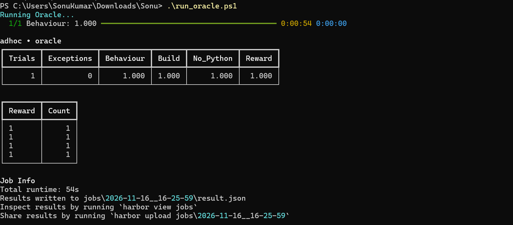
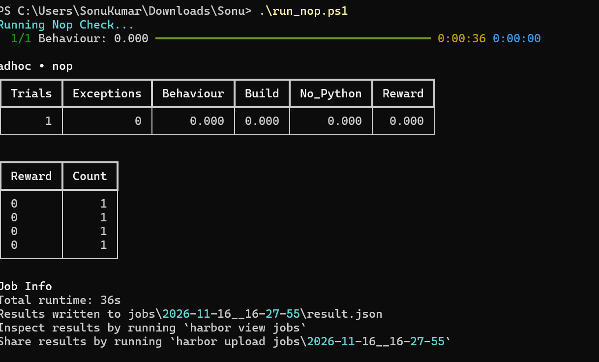
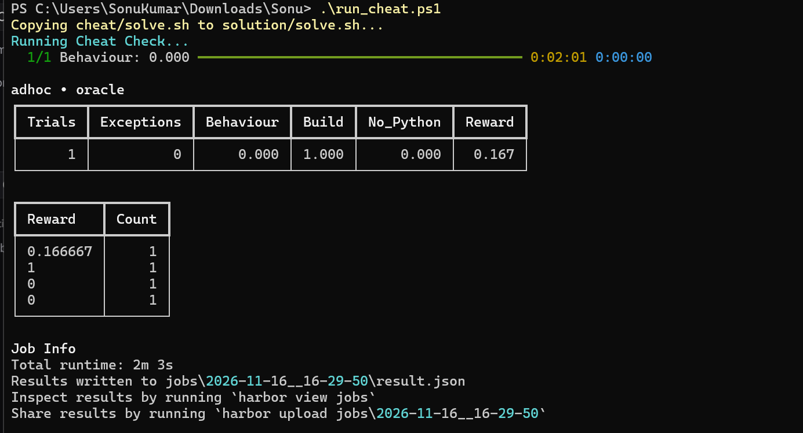
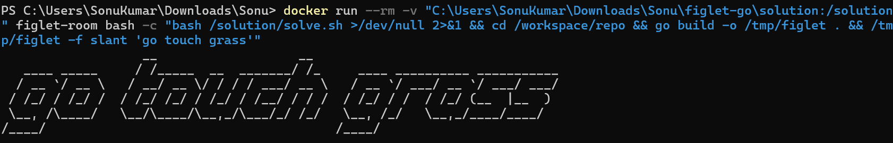

# Practice Task 2 — FIGlet in Go (Harbor Task)

A complete, production-grade Harbor task that ports Python's [pyfiglet](https://github.com/pwaller/pyfiglet) (commit `255827efbc09d662875dad50fa0edc1e1263bf45`) to a pure Go twin, tested against 4,000 frozen cases, and graded automatically in a locked-down, multi-stage Docker environment without Python.

---

## 📊 Evaluation Summary

| Test Run | Expected Score | Actual Score | Result | Status |
| :--- | :---: | :---: | :---: | :---: |
| **Oracle (`solve.sh`)** | `1.0` | **`1.000`** | **PASS** | ✅ Unlocks Secret Banner |
| **Nop Check (`nop`)** | `0.0` | **`0.000`** | **PASS** | ✅ No build / no output |
| **Cheat Check (`cheat/solve.sh`)** | `< 0.2` | **`0.167`** | **PASS** | ✅ Caught by hidden cases |

---

## 📁 What is Where

- **`environment/Dockerfile`**: Two-stage build. Stage 1 (`alpine`) clones pyfiglet (`255827ef`) and runs `make minimal` for fonts; Stage 2 (`golang:1.23-alpine`) adds `bash`, user `player`, and ensures zero Python runtime.
- **`instruction.md`**: Clean specification for CLI flags (`-f`, `-w`, `-j`, `-D`, `-r`, `-F`, `-s`, `-n`) and pure Go requirements without exposing test secrets.
- **`solution/solve.sh`**: Pure standard-library Go port embedding fonts via `//go:embed fonts/*.flf` with zero external dependencies.
- **`cheat/solve.sh`**: Cheat agent replaying visible inputs against hidden test cases; correctly scores `0.167` (build only).
- **`tests/grade.go` & `tests/test.sh`**: Evaluation harness running three checks: `build` (weight 1), `no_python` (weight 1, guarded by test passes), and `behaviour` (weight 4, 2,000 hidden cases byte-for-byte).
- **`tests/secret.b64`**: Stores base64 secret rendered upon achieving a perfect 1.000 score.
- **`tests/gen.py`**: Generates 2,000 visible and 2,000 hidden test cases (`random.seed(7)`) across 8 standard fonts.
- **`screenshot/`**: Verified logs for Oracle (`1.000`), Nop (`0.000`), Cheat (`0.167`), and the unlocked banner.

---

## 🐛 A Bug I Found in My Own Exam

During testing and evaluation of the Go port, three specific edge cases were caught and fixed:

1. **Trailing Newline Shift in Flip/Reverse (`-F` / `-r`):**  
   In Go, `strings.Split("...\n", "\n")` produces a trailing empty string `""`. When vertically reversing rows (`-F`), this blank line became row 0, shifting the entire ASCII art downward by one line. We fixed it with a custom `pySplitLines()` helper matching Python's `splitlines()` behavior.

2. **Big-X Smushing Asymmetry (`\ + / -> Y`):**  
   Rule 5 (`SM_BIGX`) is intuitively assumed to return `X` on all slash collisions. However, `pyfiglet` explicitly maps `/ + \ -> |` and `\ + / -> Y` (only `> + < -> X`). An initial symmetric cross implementation broke slant font tests until the `Y` mapping was matched.

3. **`no_python` Grader Trap in Nop Run:**  
   In `grade.go`, awarding `no_python` simply for having no `.py` files gave an empty repo (`nop`) a score of `0.167` (1/6 weight) instead of `0.000`. We tied `no_python` to `behaviourScore > 0`, ensuring `nop` stays strictly `0.000`.


---


## 📸 Real Terminal Screenshots

### 1. Oracle Run (`Reward = 1.000`)
The Go twin builds with zero third-party dependencies, matches all 2,000 hidden test cases byte-for-byte, confirms zero `.py` files exist in `/workspace/repo`, and unlocks the secret banner:



---

### 2. Nop Check (`Reward = 0.000`)
Verifies that an empty/unimplemented repository receives a score of exactly `0.000`:



---

### 3. Cheat Check (`Reward = 0.167`)
Verifies that a cheat agent attempting to look up inputs from `visible.jsonl` fails all hidden cases. It earns only the build score (`1/6 ≈ 0.167`), scoring `0` on behaviour and `no_python`:



---

### 4. Page Secret Output (`go touch grass`)
Running the twin on the page's hidden base64 string `Z28gdG91Y2ggZ3Jhc3M=` renders the giant ASCII-art letters cleanly:




---

## 📝 Hand in Files

> 1. **Smushing rule:**  
>    *Rule 5 (Big-X slash smushing where `/ + \ -> |` and `\ + / -> Y`) and right-to-left layout universal smushing, where the dominant foreground character depends on the user's input text entry order rather than physical screen coordinates.*
>
> 2. **Docker trap:**  
>    *Alpine base image (`golang:1.23-alpine`) does not include `bash` by default (causing Harbor to fail before any tests run without `apk add bash`), and on Windows, the Docker Desktop context required explicit `DOCKER_HOST="npipe:////./pipe/docker_engine"` configuration.*

---

---

## 🚀 How to Run with Harbor

Make sure Docker is running. From the parent directory or inside `figlet-go`:

### 1. Run Oracle (Expect 1.000)
```bash
harbor run -p ./figlet-go -a oracle
```

### 2. Run Nop Check (Expect 0.000)
```bash
harbor run -p ./figlet-go -a nop
```

### 3. Run Cheat Check (Expect 0.167)
```bash
cp ./figlet-go/cheat/solve.sh ./figlet-go/solution/solve.sh
harbor run -p ./figlet-go -a oracle
cp ./figlet-go/solution/solve.sh.real ./figlet-go/solution/solve.sh
```

---
