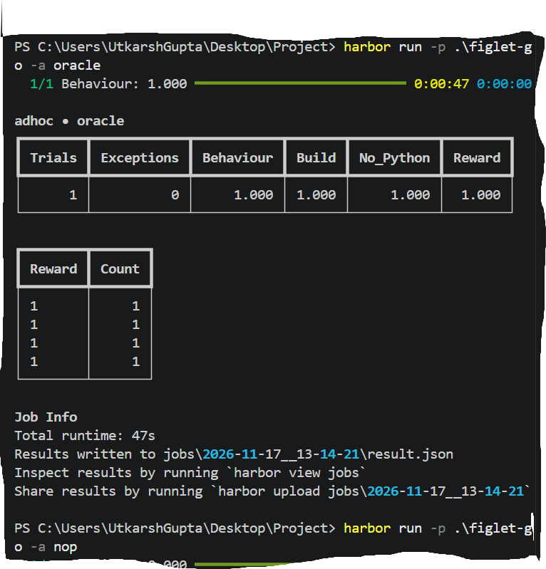
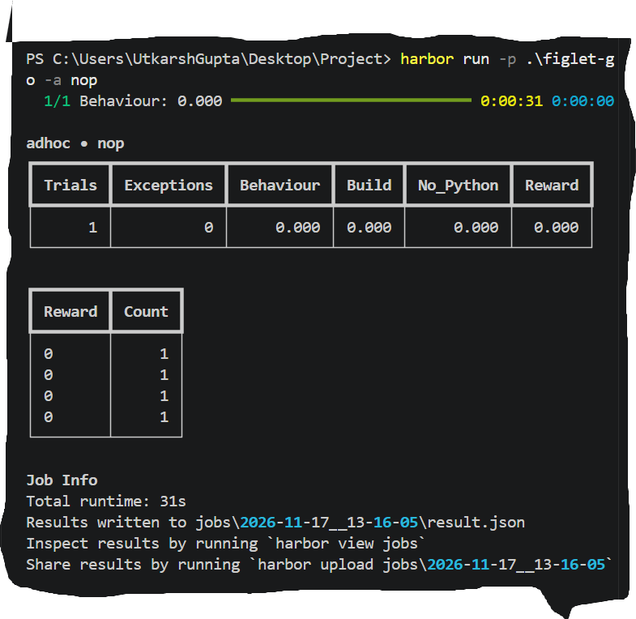
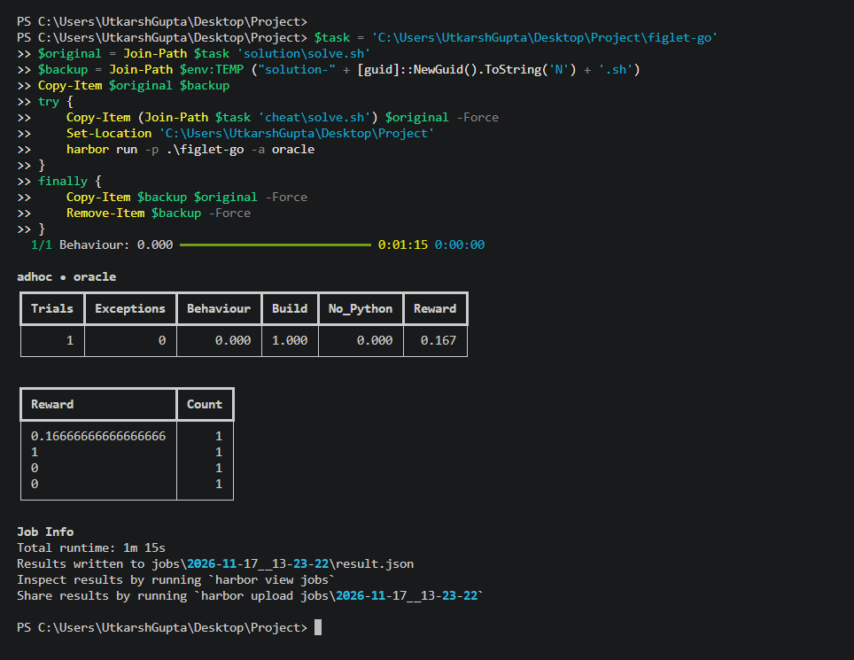

# pyfiglet to Go - FIGlet CLI

Ye project Python **pyfiglet** ke FIGlet behavior ko ek **Go command-line program** mein port karta hai. Program normal text ko selected font ke saath large ASCII art mein convert karta hai.

## Features

- Go standard library ke saath implementation
- `.flf` aur `.tlf` font files ke saath built-in font support
- Font, width, justify aur direction options
- Reverse aur flip transformations
- Surrounding newline ke liye strip aur normalize options
- Left-to-right aur right-to-left text handling
- Line wrapping, kerning aur FIGlet smushing rules
- External Python font installation ki zarurat nahi

## Requirements

- Go
- Linux/Docker environment ke liye Bash

## Build

Project folder mein jaakar build karo:

```powershell
cd "C:\Users\UtkarshGupta\Desktop\Project\Harbor_Training_2\Utkarsh Gupta\figlet-go"
go build -o figlet.exe .
```

Harbor ke Linux environment mein executable ye command se build hota hai:

```bash
go build -o /tmp/figlet .
```

## Run

Windows par:

```powershell
.\figlet.exe "Hello"
```

Font select karne ke liye:

```powershell
.\figlet.exe -f slant "Harbor"
```

Output width aur alignment:

```powershell
.\figlet.exe -f standard -w 60 -j center "Welcome"
```

## Command-Line Options

| Short option | Long option | Description |
|---|---|---|
| `-f FONT` | `--font FONT` | FIGlet font select karta hai |
| `-w COLS` | `--width COLS` | Output ki maximum width set karta hai |
| `-j MODE` | `--justify MODE` | `auto`, `left`, `center` ya `right` alignment |
| `-D MODE` | `--direction MODE` | `auto`, `left-to-right` ya `right-to-left` |
| `-r` | `--reverse` | Rendered output ko reverse karta hai |
| `-F` | `--flip` | Rendered output ko flip karta hai |
| `-s` | `--strip-surrounding-newlines` | Surrounding blank lines remove karta hai |
| `-n` | `--normalize-surrounding-newlines` | Surrounding newline count normalize karta hai |

Ek saath `-s` aur `-n` diye jaane par `-s` priority leta hai.

## Project Structure

```text
figlet-go/
|-- main.go                 # Go FIGlet implementation
|-- go.mod                  # Go module configuration
|-- instruction.md          # Original task requirements
|-- task.toml               # Harbor task configuration
|-- environment/
|   `-- Dockerfile          # Harbor runtime image
|-- solution/
|   |-- main.go             # Oracle solution source
|   |-- solve.sh            # Solution setup script
|   `-- go.mod
|-- cheat/
|   `-- solve.sh            # Anti-cheat test implementation
|-- tests/
|   |-- grade.go            # Harbor verifier
|   |-- gen.py              # Test data generator
|   |-- test_outputs.py     # Output comparison helpers
|   `-- data/               # Visible and hidden test cases
|-- fonts/                  # Bundled FIGlet fonts
|-- screenshots/            # Harbor run evidence
|-- handin-notes.txt        # Short hand-in notes
`-- README.md
```

## Tests

Root project se Go build verify karo:

```powershell
go build ./...
go test ./...
```

Harbor commands:

```powershell
harbor run -p .\figlet-go -a oracle
harbor run -p .\figlet-go -a nop
harbor run -p .\figlet-go -a cheat
```

## Harbor Results

| Run | Reward | Result |
|---|---:|---|
| Oracle | 1.000 | All implementation checks passed |
| No-op | 0.000 | Baseline implementation did not render output |
| Cheat | 0.167 | Below the 0.2 cheat threshold |

Oracle job ID:

```text
2026-11-17__13-14-21
```

## Screenshots

### Oracle



### No-op



### Cheat


