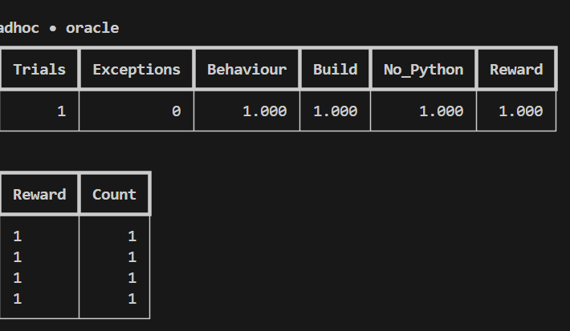
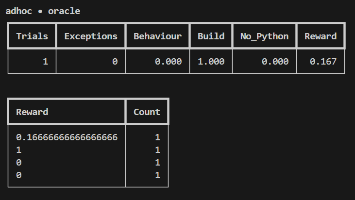

# figlet-go: Port pyfiglet to Go

## Overview

The goal of this task is to port the pinned `pyfiglet` Python command-line interface to a standalone Go program. The compiled Go binary must replicate the reference Python CLI's standard output byte-for-byte across all supported arguments, preserving all leading, trailing, and intermediate spaces and newlines.

## Reference

- **Upstream Repository:** https://github.com/pwaller/pyfiglet
- **Pinned Commit:** `255827efbc09d662875dad50fa0edc1e1263bf45`
- **Upstream Licence:** MIT License
- **Font Scope:** Standard FIGlet fonts (`fonts-standard/`) only. Contributed fonts (`fonts-contrib/`) and test fonts are excluded.

## Requirements & Supported Options

- **Go Standard Library Only:** Implemented with Go 1.23 and standard library packages only (no external dependencies).
- **Supported CLI Options:**
  - `-f FONT`: font name (default: `standard`)
  - `-w COLS`: terminal column width (default: `80`)
  - `-j auto|left|center|right`: text justification (default: `auto`)
  - `-D auto|left-to-right|right-to-left`: layout and printing direction (default: `auto`)
  - `-r`: horizontal reverse (mirror) transformation
  - `-F`: vertical flip transformation
  - `-s`: strip leading empty lines and trailing whitespace
  - `-n`: normalize surrounding newlines (`-s` takes precedence when both are provided)
  - Non-option arguments represent the message text; multiple words are joined with single spaces.
- **Build Targets:** Compiling from `/workspace/repo` must succeed for both:
  ```bash
  go build -o /tmp/figlet .
  go build ./...
  ```
- **Repository Cleanliness:** No Python source files (`.py`) may remain under `/workspace/repo`.
- **Font Availability:** Standard `.flf` font files must remain inside the repository and be embedded or accessible so `/tmp/figlet` functions from any working directory.

## Docker Environment

Defined across `environment/Dockerfile` and `task.toml`:
- **Two-Stage Docker Build:**
  - **Stage 1 (`alpine/git:2.47.2`):** Clones `pyfiglet`, checks out commit `255827efbc09d662875dad50fa0edc1e1263bf45`, verifies the commit SHA, strips `.git/`, `fonts-contrib/`, and `test-fonts/`, and prepares `/src/pyfiglet/fonts/` by copying all files from `/src/pyfiglet/fonts-standard/`.
  - **Stage 2 (`golang:1.23-alpine`):** Installs `bash`, creates non-root user `player` (UID 1000), and copies `/src` into `/workspace/repo` with `player:player` ownership. No Python runtime is installed in the final image.
- **Task Configuration (`task.toml`):**
  - Runs as non-root user `player` (UID 1000).
  - Network mode: `public`.
  - Verifier environment mode was explicitly selected as `shared` (`verifier.environment_mode = "shared"`) to match the assignment.
  - Timeouts: agent 3600s, build 900s, verifier 900s.

## Task File Layout

| Path | Description |
| --- | --- |
| `.gitattributes` | Enforces LF line endings across task text files. |
| `.gitignore` | Ignores local build artifacts, OS files (`desktop.ini`, `.DS_Store`), and secrets. |
| `NOTES.md` | Source-analysis notes analyzing `pyfiglet` font loader, smushing rules, and layout (the pinned implementation is authoritative). |
| `README.md` | Task documentation, benchmark specification, and verification evidence. |
| `task.toml` | Harbor benchmark task configuration. |
| `instruction.md` | Task instructions provided to the agent. |
| `environment/Dockerfile` | Multi-stage Docker build for source preparation and Go player runtime. |
| `solution/solve.sh` | Canonical reference oracle solution script generating the pure Go port. |
| `cheat/solve.sh` | Adversarial visible-only lookup cheat script. |
| `tests/Dockerfile` | Test container image definition. |
| `tests/test.sh` | Verifier entrypoint script (`cd /tests && go run grade.go`). |
| `tests/grade.go` | Verifier grading program evaluating build, no-python, and behavioral cases. |
| `tests/gen.py` | Deterministic test case generator for visible and hidden datasets. |
| `tests/secret.b64` | Base64-encoded secret text unlocked upon 2000/2000 matches. |
| `tests/test_outputs.py` | Legacy output comparison test script. |
| `tests/data/visible.jsonl` | 2,000 public test cases with CLI args and reference outputs. |
| `tests/data/hidden.jsonl` | 2,000 private evaluation test cases with CLI args and reference outputs. |
| `screenshot/Oracle.png` | Verifier terminal screenshot showing oracle execution and unlocked secret banner. |
| `screenshot/NOP.png` | Verifier terminal screenshot showing baseline nop run. |
| `screenshot/Cheat.png` | Verifier terminal screenshot showing visible-only cheat run. |

## Seeded Datasets

Test datasets were generated deterministically using `tests/gen.py`:
- **Deterministic Seed:** Seeded with `random.seed(7)`.
- **Case Counts:** Exactly 2,000 visible records (`tests/data/visible.jsonl`) and 2,000 hidden records (`tests/data/hidden.jsonl`).
- **Disjoint Splits:** Zero argument-array overlap between visible and hidden datasets (`len(visible & hidden) == 0`), with all 2,000 argument lists within each split being unique.
- **Reference Output Fidelity:** Captured directly from the reference Python CLI stdout without trimming or normalizing characters.
- **Coverage:** Exercises all eight standard fonts (`standard`, `slant`, `small`, `big`, `mini`, `banner`, `shadow`, `script`), column widths 10-120, justifications, directions, transformations (`-r`, `-F`, `-s`, `-n`), boundary whitespace, long text requiring multiline wrapping, and extended Unicode characters.

## Grader Formula

Evaluation is performed automatically by `tests/grade.go` and written to `/logs/verifier/reward.json`:

$$\text{reward} = \frac{\text{build} + \text{no\_python} + 4 \times \text{behaviour}}{6}$$

- **`build` (weight: 1/6):** Awards `1.0` if both `go build -o /tmp/figlet .` and `go build ./...` succeed from `/workspace/repo`; otherwise `0.0`.
- **`no_python` (weight: 1/6):** Awards `1.0` if `build == 1.0`, zero `.py` files remain in `/workspace/repo`, and `matchingCases >= 1`; otherwise `0.0`.
- **`behaviour` (weight: 4/6):** Evaluates all 2,000 hidden cases from `tests/data/hidden.jsonl`. Each case runs `/tmp/figlet [args...]` from `/tmp` with a 5-second timeout. Score is `matchingCases / 2000.0`.
- **Secret Unlock Mechanism:** If all 2,000 hidden cases pass, `grade.go` decodes `tests/secret.b64` and renders the banner using `/tmp/figlet -f slant <decoded>`. If any case fails, it outputs `No secret for you. Yet.`.

## Verified Results

The following evaluation scores were recorded from user-executed Harbor job runs:

| Run | Build | No_python | Behaviour | Total Reward |
| --- | :---: | :---: | :---: | :---: |
| **Oracle** (`solution/solve.sh`) | 1.0 | 1.0 | 1.0 | **1.000000** |
| **NOP Baseline** | 0.0 | 0.0 | 0.0 | **0.000000** |
| **Visible Cheat** (`cheat/solve.sh`) | 1.0 | 0.0 | 0.0 | **0.166667** ($1/6$) |

### Run Highlights

- **Oracle:** The actual Go executable compiled cleanly, removed all Python files, and achieved 2000/2000 exact byte matches on hidden cases (and 2000/2000 on visible cases), successfully unlocking the task banner.
- **NOP Baseline:** Failed the build step immediately as expected, receiving 0.0 across all components.
- **Cheat:** Successfully compiled and embedded visible cases (`build = 1.0`), but achieved 0/2000 on hidden cases due to disjoint datasets. Because `matchingCases == 0`, `no_python` remained 0.0, yielding a reward of 0.16666666666666666 ($1/6$) with no secret revealed.
- **Restoration:** The real oracle was restored and its SHA256 hash verified after testing the cheat.

## Commands to Run Evaluation

From the `Harbor_Training_2` repository root in PowerShell:

```powershell
harbor run -p ".\Vishu Porwal\figlet-go" -a oracle
harbor run -p ".\Vishu Porwal\figlet-go" -a nop
```

## Honest Reflections

- **Smushing:** No rendering-rule failure was observed in the recorded runs; Big-X required care because its code differs from its comment.
- **Docker:** No build failure occurred; font preparation, Alpine, and bash addressed the required setup traps.
- **Verifier Configuration:** Shared verification was explicitly selected in `task.toml` (`verifier.environment_mode = "shared"`) to match the assignment.

## Known Limitations

- **Oversized Glyphs:** Glyphs whose width exceeds `-w` are skipped during rendering in `solution/solve.sh` rather than raising pyfiglet's uncaught `CharNotPrinted` exception. Failed reference invocations were excluded from the datasets and error-path equivalence is unverified.

## Verification Evidence

### Screenshots

- **Oracle Run:**
  

- **NOP Baseline Run:**
  

- **Cheat Run:**
  
