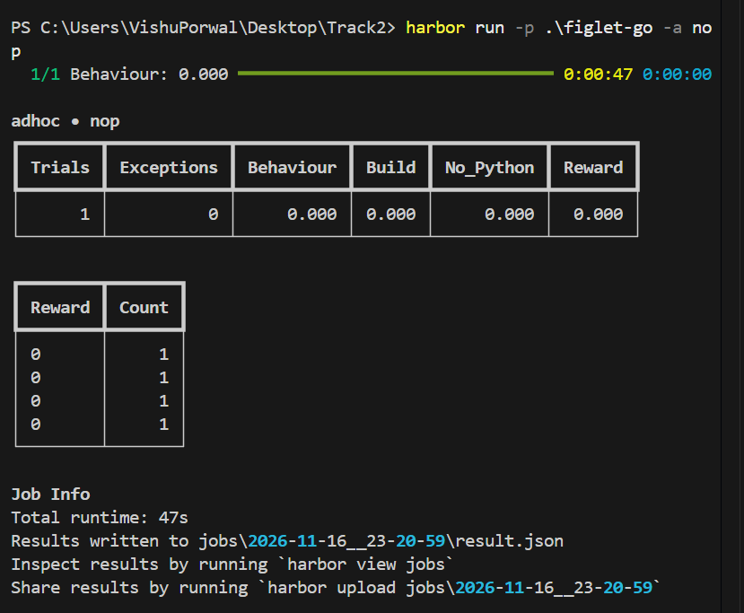

# figlet-go: Port pyfiglet to Go

## Overview

This Harbor task asks an agent to port the pinned `pyfiglet` Python CLI to a standalone Go program. The executable must match the original CLI's stdout byte for byte, including spaces and newlines.

The task includes a Docker environment, reproducible datasets, a Go grader, an oracle solution, and a visible-answer lookup cheat used to validate the evaluation.

## Reference

- **Upstream:** https://github.com/pwaller/pyfiglet
- **Pinned commit:** `255827efbc09d662875dad50fa0edc1e1263bf45`
- **Commit date:** `2026-08-02T22:51:18+01:00`
- **Upstream licence:** MIT
- **Font scope:** Standard fonts only; contributed and test fonts are excluded.

The pinned implementation is authoritative. `NOTES.md` records source analysis and development observations.

## Requirements

The finished solution must:

- Use Go 1.23 and the Go standard library only.
- Match the reference CLI's output exactly.
- Remove all `.py` files from `/workspace/repo`.
- Preserve standard `.flf` fonts inside the repository.
- Work when invoked from any working directory.
- Pass both build commands from `/workspace/repo`:

```bash
go build -o /tmp/figlet .
go build ./...
```

### Supported Options

| Option | Purpose |
| --- | --- |
| `-f FONT` | Font selection; default `standard` |
| `-w COLS` | Layout width; default `80` |
| `-j auto\|left\|center\|right` | Justification; default `auto` |
| `-D auto\|left-to-right\|right-to-left` | Rendering direction; default `auto` |
| `-r` | Mirror rendered output horizontally |
| `-F` | Flip rendered output vertically |
| `-s` | Strip surrounding blank lines and trailing whitespace |
| `-n` | Normalize surrounding newlines |

Automatic direction follows the font. Automatic justification follows the resolved direction. Explicit justification uses the selected width.

Multiple text arguments are joined with single spaces. When both `-s` and `-n` are supplied, `-s` takes precedence.

Performance, memory use, error-message wording, and options `-c`, `-L`, `-l`, and `-i` are outside the grading scope.

## Docker Environment

The Dockerfile uses two stages:

1. **Source preparation — `alpine/git:2.47.2`**
   - Clones the upstream repository.
   - Checks out and verifies the pinned commit.
   - Removes Git metadata, contributed fonts, and test fonts.
   - Copies `pyfiglet/fonts-standard/*` into `pyfiglet/fonts/`.

2. **Agent environment — `golang:1.23-alpine`**
   - Installs bash.
   - Creates non-root user `player`, UID 1000.
   - Copies the prepared source into `/workspace/repo` with player ownership.
   - Contains no Python interpreter.

The final environment uses:

```text
USER player
WORKDIR /workspace/repo
CGO_ENABLED=0
GOTOOLCHAIN=local
```

Runtime checks confirmed the user, UID, working directory, 72 prepared font files, bash availability, repository write access, and absence of `python` and `python3` commands.

### Harbor Configuration

| Setting | Value |
| --- | --- |
| Agent user | `player` |
| Agent timeout | 3600 seconds |
| Environment build timeout | 900 seconds |
| Verifier timeout | 900 seconds |
| Network mode | `public` |
| Verifier mode | `shared` |

The generated verifier mode was explicitly changed from `separate` to `shared` to match the assignment.

## File Layout

| Path | Purpose |
| --- | --- |
| `.gitattributes` | Preserves LF endings for text files |
| `.gitignore` | Excludes local artifacts, OS metadata, and `.env` files |
| `NOTES.md` | Source-analysis notes and candidate edge cases |
| `README.md` | Task documentation and validation results |
| `task.toml` | Harbor configuration |
| `instruction.md` | Instructions presented to the solving agent |
| `environment/Dockerfile` | Two-stage source preparation and agent environment |
| `solution/solve.sh` | Writes and builds the oracle's Go implementation |
| `cheat/solve.sh` | Writes a visible-answer lookup implementation |
| `tests/gen.py` | Generates cases using the original CLI |
| `tests/data/visible.jsonl` | 2,000 visible cases and reference outputs |
| `tests/data/hidden.jsonl` | 2,000 hidden evaluation cases and reference outputs |
| `tests/grade.go` | Go grader |
| `tests/test.sh` | Active verifier entrypoint |
| `tests/secret.b64` | Encoded task message, rendered after perfect behaviour |
| `tests/Dockerfile` | Retained scaffold file; verification uses the shared environment |
| `tests/test_outputs.py` | Retained scaffold file; not invoked by the active verifier |
| `screenshot/Oracle.png` | Oracle reward table |
| `screenshot/NOP.png` | Nop evaluation result |
| `screenshot/Cheat.png` | Cheat evaluation result |

Hidden cases are withheld from the solving agent during evaluation. Their presence in this submission repository does not make them confidential.

## Dataset Generation

The generator uses `random.seed(7)` and runs the original Python CLI to obtain every expected output.

- Exactly **2,000 visible** and **2,000 hidden** records.
- Unique argument arrays within each split.
- **Zero argument-array overlap** between splits.
- Stdout captured without whitespace or newline normalization.
- Failed or timed-out reference invocations excluded.

Coverage includes:

- Fonts: `standard`, `slant`, `small`, `big`, `mini`, `banner`, `shadow`, `script`.
- Widths: `10`, `20`, `40`, `60`, `80`, `120`.
- All supported justification and direction values.
- Boolean-option combinations, including `-s` with `-n`.
- Punctuation, repeated characters, boundary whitespace, Latin-1 characters, and missing glyphs.
- Long text requiring multiline wrapping.
- Right-to-left rendering combined with narrow widths.

Two generation runs produced identical hashes for both datasets. Independent checks validated file structure, encoding, record counts, uniqueness, and split separation. Three selected cases were rerun against the reference and matched byte for byte.

### Regenerate Answers

Keep the pinned, font-prepared `pyfiglet` checkout beside `figlet-go`. From the task folder in PowerShell:

```powershell
$env:PYTHONUTF8 = '1'
$env:PYTHONDONTWRITEBYTECODE = '1'
python .\tests\gen.py
```

Never edit expected outputs manually.

## Grading

The active verifier runs:

```bash
cd /tests && go run grade.go
```

It writes `/logs/verifier/reward.json` using:

```text
reward = (build + no_python + 4 × behaviour) / 6
```

| Component | Weight | Condition |
| --- | ---: | --- |
| `build` | 1 | Both required Go build commands succeed |
| `no_python` | 1 | Build succeeds, no `.py` files remain, and at least one hidden case matches |
| `behaviour` | 4 | Fraction of hidden cases producing exact stdout with successful execution |

Each behavioural invocation runs from `/tmp` with a five-second timeout. A failed or timed-out process cannot receive a match.

Only a perfect behavioural result triggers decoding and rendering of the task's encoded message. Otherwise the grader prints:

```text
No secret for you. Yet.
```

## Verified Results

Evidence: user-executed runs and inspected verifier output.

| Run | Build | No Python | Behaviour | Reward |
| --- | ---: | ---: | ---: | ---: |
| Oracle | 1 | 1 | 1 | **1.0** |
| Nop | 0 | 0 | 0 | **0.0** |
| Visible-answer cheat | 1 | 0 | 0 | **0.16666666666666666** |

- The actual compiled Go executable matched **2,000/2,000 visible cases**.
- The Harbor oracle matched **2,000/2,000 hidden cases** and unlocked the task banner.
- The cheat matched **0/2,000 hidden cases** and received no secret.
- The real oracle was restored after the cheat run, with its original SHA256 hash verified.

These results establish correctness on the generated datasets, not every possible input.

### Run Evaluation

From the `Harbor_Training_2` repository root in PowerShell:

```powershell
harbor run -p ".\Vishu Porwal\figlet-go" -a oracle
harbor run -p ".\Vishu Porwal\figlet-go" -a nop
```

Inspect the new job's `verifier/reward.json` and `verifier/test-stdout.txt`. A successful Harbor exit alone does not establish the expected reward.

The cheat was evaluated through the oracle runner by temporarily substituting its script, then restoring the real oracle with a guarded backup-and-restore procedure. Its screenshot therefore carries the runner label `oracle`.

## Screenshots

### Oracle — Reward 1.0

The screenshot shows the reward table. The unlocked task banner was verified separately in the verifier log.


### Nop — Reward 0.0



### Cheat — Reward Below 0.2


## Reflection

- **Smushing:** No rendering-rule failure was observed in the recorded compiled-port runs. Big-X required care because `/` followed by `\` returns `|`, despite the misleading source comment.
- **Docker:** No Docker build failure occurred. Standard-font preparation, Go Alpine, and explicit bash installation addressed the required setup traps.

## Known Limitation

The reviewed oracle skips glyphs wider than the selected width, whereas the Python reference raises `CharNotPrinted`. Failed reference invocations were excluded from the datasets, so error-path equivalence remains unverified.
