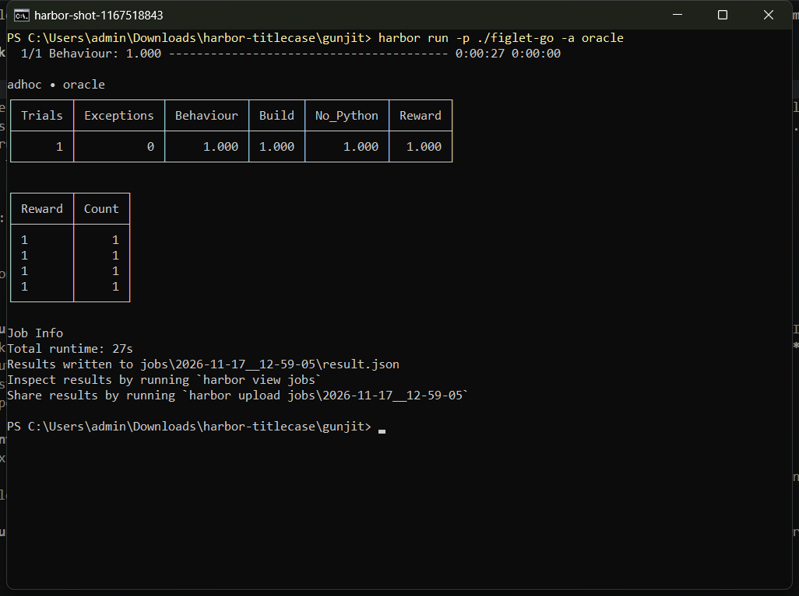
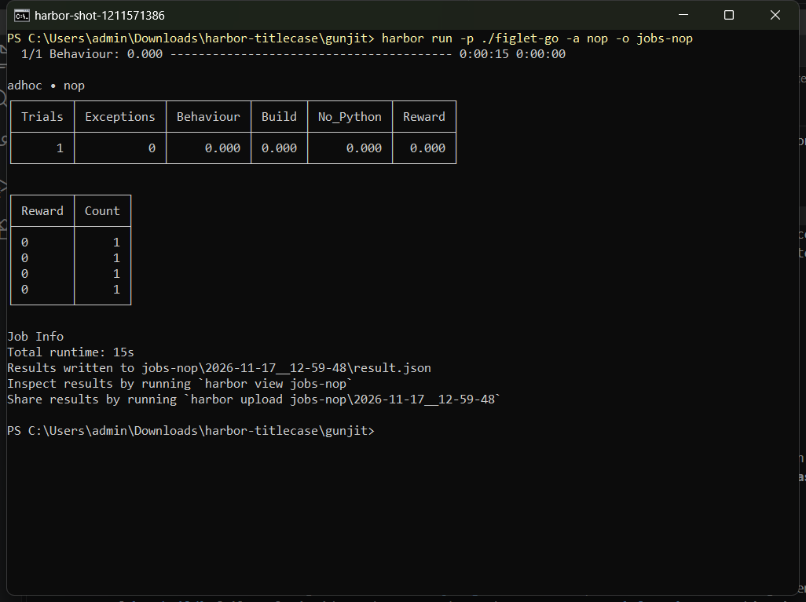
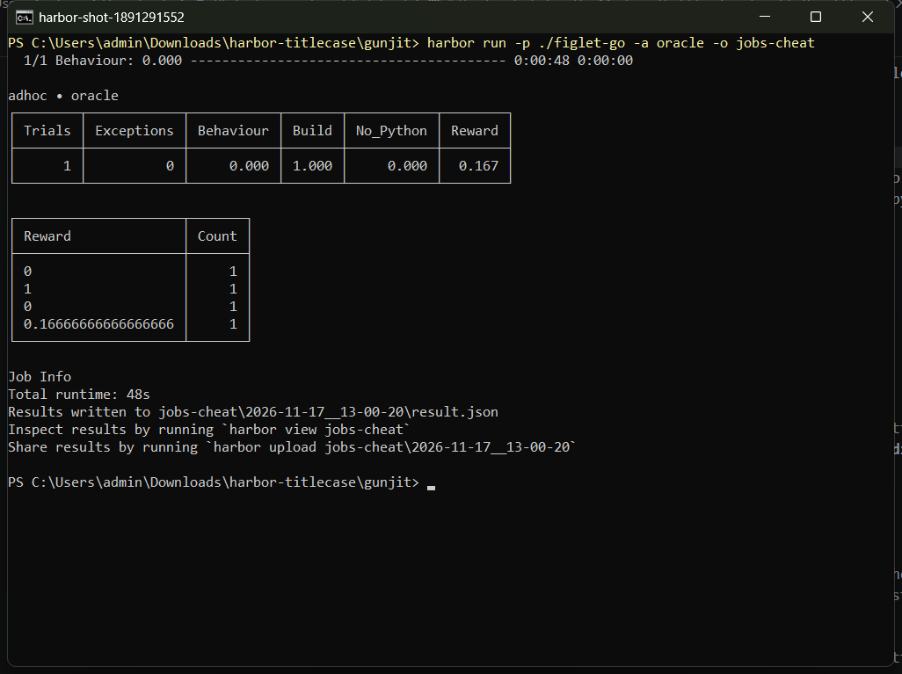

# gunjit/figlet-go — Harbor practice task 2

Port pyfiglet (the Python FIGlet) to Go, byte for byte, inside a two-stage Docker
room that contains no Python. Built by gunjit, 2026-11-17.

## Results (each run done twice, same numbers both times)

| run | command | reward | build | no_python | behaviour | secret |
|---|---|---|---|---|---|---|
| oracle | `harbor run -p ./figlet-go -a oracle` | **1.000** | 1 | 1 | 1.000 (2000/2000) | drawn in slant |
| nop | `harbor run -p ./figlet-go -a nop -o jobs-nop` | **0.000** | 0 | 0 | 0.000 | "No secret for you. Yet." |
| cheat | `cheat/` copied over `solution/`, then the oracle command | **0.167** | 1 | 0 | 0.000 (0/2000) | "No secret for you. Yet." |

Screenshots (real console captures of the second round):

- 
- 
- 

Hand-worked expectation: nothing = 0, build only = 1/6 ≈ 0.167, perfect = 1.0. The cheat
lands exactly on "build only" because `no_python` is tied to at least one right hidden
answer, so deleting the `.py` files alone pays nothing.

## Two honest lines

1. **Which smushing rule broke the agent most:** none, in the end: the port matched 4000/4000
   cases on its first run because every rule was transcribed from `FigletBuilder` instead of
   re-derived. What did bite was not a rule but pyfiglet's own wrapping code: a glyph exactly
   as wide as `-w` with no leading blank column (slant `H`/`E`/`N` at `-w 10`) makes the
   original loop forever, and in right-to-left mode the same trap is on the *trailing*
   column. The first generator run hung on that; `gen.py` now skips those inputs and has a
   watchdog.
2. **Which Docker trap I hit:** the three documented ones were avoided by reading the sheet
   (Alpine Go image, `apk add bash`, stage 1 fetching from GitHub). The ones I actually hit
   were smaller: `harbor task init` is interactive on Windows and needs `--org`/`--author`,
   and `go build ./...` inside `solve.sh` dropped a stray `figlet` binary into the repo
   (now `go build -o /dev/null ./...`).

## Layout

```
figlet-go/
  NOTES.md               source SHA, licence, font setup, the six smushing rules, rare cases
  instruction.md         what the agent must build (no tests, no secret mentioned)
  task.toml              agent user=player, 3600 s; verifier 900 s shared; network public
  environment/Dockerfile two stages: alpine+git fetches pyfiglet@255827ef -> golang:1.23-alpine room
  tests/gen.py           seeded (7) generator; answers come only from pyfiglet.main()
  tests/data/visible.jsonl, hidden.jsonl   2000 cases each, disjoint, identical on regeneration
  tests/grade.go, test.sh                  Go grader -> /logs/verifier/reward.json
  tests/secret.b64       the author's secret, drawn by the twin when behaviour == 1.0
  solution/              oracle: solve.sh + go.mod + main.go + figlet.go (stdlib only, fonts via go:embed)
  cheat/                 lookup table of the visible cases; proves the hidden set catches it
  screenshots/           oracle.png, nop.png, cheat.png
```

## Reproduce

```
docker build -t figlet-room figlet-go/environment/
docker run --rm figlet-room sh -c 'whoami; pwd; ls pyfiglet/fonts | wc -l; command -v python3 || echo NO_PYTHON; command -v bash; touch x && echo CAN_WRITE'
harbor run -p ./figlet-go -a oracle
harbor run -p ./figlet-go -a nop -o jobs-nop
```

Regenerate the cases (needs the pyfiglet checkout next to this folder, fonts copied as in
NOTES.md): `python tests/gen.py`, run it twice and `diff` — the files are identical.

## The page's secret

Inside the room, with the oracle's code built:

```
cd /workspace/repo && go build -o /tmp/figlet . && /tmp/figlet -f slant "$(echo Z28gdG91Y2ggZ3Jhc3M= | base64 -d)"
```

```
                   __                   __                                 
   ____ _____     / /_____  __  _______/ /_     ____ __________ ___________
  / __ `/ __ \   / __/ __ \/ / / / ___/ __ \   / __ `/ ___/ __ `/ ___/ ___/
 / /_/ / /_/ /  / /_/ /_/ / /_/ / /__/ / / /  / /_/ / /  / /_/ (__  |__  ) 
 \__, /\____/   \__/\____/\__,_/\___/_/ /_/   \__, /_/   \__,_/____/____/  
/____/                                       /____/                        
```

Clean letters: the exam holds.
